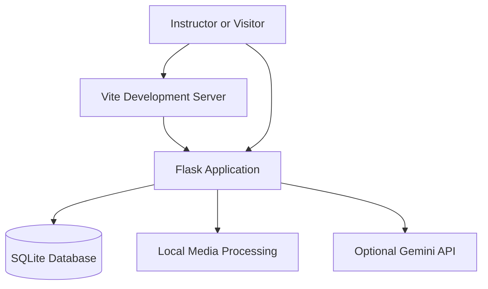

# Classroom Insight

## SkillWallet master implementation update

The existing React/Flask product now includes **System Diagnostics** (`/app/diagnostics`), **Session Evidence** (`/app/insights`), configurable weighted activity scores and experimental change alerts, track/audit timelines, student attendance evidence, richer recorded-audio analysis, and an optional **Streamlit analytics dashboard**. Live Monitor and secure Gemini/Groq settings remain in place. New reports use existing data, with no schema migration or data reset.

Recorded PCM WAV analysis optionally uses Librosa/SciPy for mono 16 kHz normalization, RMS, zero crossings, centroid, rolloff, energy, noise-like labels, bounded waveform envelopes and coarse spectrograms. It does not recognize speech or identify speakers. Live microphone monitoring remains lightweight RMS without raw-audio retention. Missing signals and unknown attendance duration remain explicitly unavailable.

**Verified:** 145 Python tests (including 3 Streamlit tests), 76 frontend tests, TypeScript and production build. Browser access is permission-blocked; real hardware and new screenshots remain pending. The current pinned dependency baseline requires Python >=3.12; Python 3.13.15 was tested. MediaPipe landmarks and head pose remain unsupported; FFmpeg extraction is unavailable on this machine until FFmpeg is installed.

See the [activity matrix](docs/REQUIREMENTS_AUDIT.md), [submission results and file manifest](docs/SUBMISSION_STATUS.md), [system diagnostics](docs/SYSTEM_DIAGNOSTICS.md), and [Streamlit guide](docs/STREAMLIT_DASHBOARD.md). These current sections supersede earlier dated verification counts.

Optional dependencies, from `D:\Coding\classroom-insight`:

```powershell
.\.venv\Scripts\python.exe -m pip install -r requirements-audio.txt -r requirements-dashboard.txt -c requirements-lock-python313-windows.txt
.\.venv\Scripts\python.exe -B scripts/validate_environment.py --imports
```

Keep the existing Flask/Vite commands below. For Streamlit, in another terminal in the same project:

```powershell
.\.venv\Scripts\python.exe -m streamlit run streamlit_app.py --server.address 127.0.0.1 --server.port 8501
```

Open http://127.0.0.1:8501 and use the documented demo employee login. It reads authenticated Flask reports, never SQLite or provider credentials directly. Do not expose the demo services publicly.


## Continuous Live Monitor — current extension

Open **Live Monitor** in the existing dashboard (`/app/live`). It provides an opt-in continuous camera preview, sampled OpenCV face detection, anonymous IDs, conservative sustained-presence qualification, explicit roster confirmation, optional microphone RMS monitoring, aligned activity windows and evidence-linked suggestions. The dark forest workspace complements the existing dashboard; recorded video/audio and snapshot upload remain available.

Start camera and microphone separately after participant authorization. No raw live frames/audio are saved: only numerical observations and explicitly confirmed attendance are retained. Head pose, gaze, speech recognition and individual attention scores are unsupported. Use **End session** before navigating. Hidden tabs, device loss and backend failures stop devices; restart explicitly to recover.

Read [Live Monitor guide](docs/LIVE_MONITOR.md) for architecture, thresholds, privacy, measured synthetic performance, test evidence and the manual demo checklist. **Real browser/hardware verification is pending:** browser control is permission-disabled. The guide also discloses two empty QA sessions accidentally added during the initial HTTP check; no previous classroom records were removed.

Run from `D:\Coding\classroom-insight`:

```powershell
.\.venv\Scripts\python.exe -m backend.app
```

In a separate terminal in the same folder:

```powershell
npm run dev
```

Restart an older Flask process in its own terminal first; `/api/live/start` is new. Open `http://127.0.0.1:5173/app/live`. Do not terminate unrelated processes. The normal single-process Flask command is required for the in-memory live registry.


### Multimodal Attendance & Engagement Agent

A local-first instructor workspace for roster-based attendance, classroom activity analysis, engagement insights, and evidence-linked teaching suggestions.

[](https://react.dev/)
[](https://www.typescriptlang.org/)
[](https://vite.dev/)
[](https://flask.palletsprojects.com/)
[](https://sqlite.org/)

Classroom Insight combines a modern instructor dashboard with local data persistence, video and audio signal analysis, attendance tracking, reporting, and optional Gemini-powered recommendations.

It is designed as a **single-instructor local demonstration**, not a hosted, multi-tenant institutional service.

**Submission update:** See [Submission Status](docs/SUBMISSION_STATUS.md) for the tested demo path, new face/presence observations, attendance timestamps/history, signal fusion, exact validation results and limitations. [Requirements Audit](docs/REQUIREMENTS_AUDIT.md) distinguishes completed features from partial requirements.

## Contents

### October 30 capstone update

The **Upload recording → Camera / microphone** tab now provides opt-in browser capture: timestamped camera snapshots (every two seconds, maximum 60) or microphone PCM WAV (maximum two minutes). Preview, stop and explicitly upload for local analysis; closing the form releases the device. Live capture is not continuous live inference, and camera snapshots do not include audio. Device permission/hardware verification remains a manual step; recorded uploads continue to work.

Settings now expose sustained-presence duration/sample thresholds and the still-motion threshold. Face thumbnails are optional and **off by default for new analyses**. Existing images are not erased by changing the preference. Genuine head pose is unsupported; eye-line roll is a separate 2D image heuristic, not a pose estimate. Reports retain analysis preferences/provenance and exclude thumbnails.

Latest verification: **79 backend tests; 43 frontend tests; TypeScript and production build passed**. Browser login, session creation, mobile/desktop capture controls and setting persistence were verified on an isolated database. See [the current 15-requirement matrix](docs/REQUIREMENTS_AUDIT.md#capstone-compliance-matrix--30-october-2026) and [submission guide](docs/SUBMISSION_STATUS.md). The official SkillWallet brief screenshot/report template remain unavailable; the Markdown report does not claim to satisfy that template.

- [Features](#features)
- [Product screenshots](#product-screenshots)
- [Technology stack](#technology-stack)
- [Architecture](#architecture)
- [Getting started](#getting-started)
- [Demo walkthrough](#demo-walkthrough)
- [Attendance and engagement methodology](#attendance-and-engagement-methodology)
- [Media analysis](#media-analysis)
- [AI capabilities](#ai-capabilities)
- [Testing and verification](#testing-and-verification)
- [Privacy and security](#privacy-and-security)
- [Known limitations](#known-limitations)
- [Documentation](#documentation)

## Features

### Instructor workspace

- **Overview dashboard** — classroom summaries, key metrics, and trends.
- **Attendance management** — session rosters, attendance confirmation, and historical records.
- **Session management** — create and manage classroom sessions and associated analyses.
- **Engagement analytics** — visualize observable signals and session-level trends.
- **Teaching recommendations** — evidence-linked suggestions with a deterministic local fallback.
- **Student management** — manage students and review their session histories.
- **Reports and exports** — inspect and export available classroom information.
- **Settings** — configure available options and manage sample data and media retention.

### Public institutional website

The public homepage introduces the product and provides navigation to its main sections. It uses locally bundled DM Serif Display and Manrope fonts, an ivory-and-forest-green palette, a custom SVG brand mark, and an illustrative product preview.

The homepage includes:

- Product and workflow explanations.
- Illustrative seminar and workshop examples.
- Employee Login.
- A multi-stage consultation request form.
- An Institution Readiness Brief powered by an optional Gemini API connection.

Illustrative examples are explicitly labelled. They are not presented as live classroom observations or measured outcomes.

### Local data and media processing

- SQLite-backed persistence.
- Session-specific attendance records and historical roster snapshots.
- Video and audio signal analysis using available local processing libraries.
- Synthetic sample data for demonstrations.
- CSV, JSON, and PDF exports where supported.
- Optional AI-generated teaching suggestions and institutional readiness guidance.

## Product screenshots

Screenshots should be genuine captures of the running application. The following paths assume the corresponding PNG files have been saved and verified in `docs/screenshots/`.

### Public website

| Screen | Screenshot |
|---|---|
| Homepage | `docs/screenshots/public-homepage.png` |
| Employee Login | `docs/screenshots/employee-login.png` |
| Consultation Form | `docs/screenshots/consultation-form.png` |

### Instructor dashboard

| Screen | Screenshot |
|---|---|
| Dashboard Overview | `docs/screenshots/dashboard.png` |
| Attendance | `docs/screenshots/attendance.png` |
| Sessions | `docs/screenshots/sessions.png` |
| Engagement Analytics | `docs/screenshots/engagement-analytics.png` |
| Recommendations | `docs/screenshots/recommendations.png` |
| Students | `docs/screenshots/students.png` |
| Reports | `docs/screenshots/reports.png` |
| Settings | `docs/screenshots/settings.png` |

See the [screenshot guide](docs/screenshots/README.md) for capture instructions and privacy checks.

## Technology stack

| Layer | Technologies |
|---|---|
| Frontend | React, TypeScript, Vite |
| Styling and UI | Tailwind CSS v4, Lucide React, Recharts, React Router |
| Backend | Python, Flask |
| Database | SQLite |
| Media processing | OpenCV, NumPy, optional FFmpeg |
| AI integration | Official `google-genai` Python SDK |
| Validation | Pydantic, frontend and backend tests |

Dependency versions and supported ranges are recorded in the npm lockfile and Python requirements files.

## Architecture

The application has two main execution modes:

1. **Development:** Vite serves the frontend and proxies `/api` requests to Flask.
2. **Local production-style mode:** Flask serves the built frontend and the API from the same origin.

The database and media files are stored locally. Optional Gemini requests are sent through the Flask backend; the API key must never be placed in frontend code.



The public homepage is available at `/`, and the operational workspace is under `/app`. Dashboard APIs and operational routes require demo access.

See [ARCHITECTURE.md](docs/ARCHITECTURE.md) for the implementation diagrams, request flows, and database relationships.

## Getting started

### Prerequisites

- Node.js 22.12 or later; Node.js 26 was used for verification.
- Python 3.12 or later for the current pinned dependencies; Python 3.13.15 was used for verification.
- Windows PowerShell for the commands below.

### 1. Open the project

```powershell
cd D:\Coding\classroom-insight
```

### 2. Set up the Python environment

Run these commands from the project root:

```powershell
python -m venv .venv
.\.venv\Scripts\python.exe -m pip install -r requirements.txt
```

Create `.env` only if it does not already exist:

```powershell
Copy-Item .env.example .env
```

Configure a strong, random `FLASK_SECRET_KEY` in `.env`. Gemini configuration is optional.

**Do not overwrite an existing `.env` file**, and never commit API keys or secrets to Git.

### 3. Start the backend

In the first PowerShell terminal:

```powershell
cd D:\Coding\classroom-insight
.\.venv\Scripts\python.exe -m backend.app
```

Keep this terminal running.

### 4. Start the frontend

Open a second terminal:

```powershell
cd D:\Coding\classroom-insight
npm ci
npm run dev
```

Keep this terminal running as well.

### 5. Open the application

- **Development frontend:** http://127.0.0.1:5173/
- **Local Flask application:** http://127.0.0.1:5000/

During development, use the Vite URL. Vite proxies API requests to Flask at `127.0.0.1:5000`.

Do not expose either development server to an untrusted network.

### Optional: Run the built application

After building the frontend:

```powershell
npm run build
```

The project also supports serving the built SPA through Waitress:

```powershell
.\.venv\Scripts\waitress-serve.exe --listen=127.0.0.1:5000 --threads=4 --call backend.app:create_app
```

Use only one application process because analysis-job concurrency is process-local. This is a local serving option, not a production security certification.

## Demo walkthrough

### Employee Login

The application includes a deliberately public demonstration account.

| Field | Demo value |
|---|---|
| Email | `instructor@classroom.demo` |
| Password | `ClassroomDemo!2026` |

These are demonstration credentials, not real employee accounts.

The server stores a hash of an opaque session token in SQLite and issues an HttpOnly, SameSite=Strict cookie. Normal sessions expire after eight hours; Remember me enables a seven-day persistent cookie. The dashboard displays a Demo Mode indicator.

Sign Out revokes the server-side token, clears the cookie, and returns the user to the public homepage.

This mechanism is intended for demonstration only. It does not provide institutional identity management, role-based access, or tenant isolation.

### Explore sample data

1. Open the homepage and choose **Employee Login**.
2. Sign in using the demo credentials.
3. Choose **Explore sample data** on Overview or use Settings → **Load sample data**.
4. Explore the eight operational sections.
5. Inspect attendance, session histories, analytics, recommendations, and exports.
6. Use Settings → **Reset sample data** if you want to remove the sample records after confirmation.

The sample dataset contains six fictional sessions and twelve fictional students. Loading it repeatedly is designed to be safe.

Sample students do not automatically enter real session rosters. Uploaded media cannot be attached to sample sessions.

The initial workspace is empty until data is explicitly created or loaded.

### Request a Consultation

The consultation form has four stages: contact, organization, requirements, and review.

- Phone and contact consent are optional.
- Consent starts unchecked.
- Browser and backend validation are applied.
- An idempotency key helps prevent duplicate records on retries.
- Successful submissions receive a server-generated `CI-…` reference.

Consultation requests persist in the `institutional_enquiries` table in `data/classroom.sqlite3`.

**The form does not send email.** Production notifications require a separately configured service.

To inspect enquiry metadata without printing contact details:

```powershell
.\.venv\Scripts\python.exe scripts/inspect_enquiries.py
```

To inspect a particular reference:

```powershell
.\.venv\Scripts\python.exe scripts/inspect_enquiries.py --reference CI-REPLACE_WITH_REFERENCE
```

The enquiry database is not cleared when sample classroom data is reset.

### Institution Readiness Brief

The readiness form accepts institution type, workflow goals, requirements, and deployment preferences.

Choose **Use sample information** to populate fictional inputs, then choose **Generate Brief** to explicitly request a Gemini-generated result through Flask.

The backend:

1. Uses `backend/capabilities.json` as the maintained capability catalogue.
2. Maps model-selected capability IDs to server-maintained descriptions.
3. Adds known limitations and validates the result using Pydantic.
4. Checks response structure and length bounds.

Generated results are labelled **Generated by Gemini · advisory**.

If configuration, model access, quota, or response validation fails, the interface should present an explicit error and retry option rather than claiming that static text is an AI-generated result.

Avoid entering personal or confidential information. The readiness workflow is not an automated anonymization service.

## Attendance and engagement methodology

### Attendance

Attendance rates are calculated as confirmed-present entries divided by all roster entries, including unconfirmed entries.

Aggregate rates use student-session entries rather than unique students. Historical rosters are stored as snapshots.

Anonymous person detection does not automatically mark attendance.

New confirmations record UTC `confirmed_at`, `updated_at` and their source, with per-student status-change history. The first startup after this update makes a SQLite backup under `data/backups/` before adding these fields. Existing status/roster data is preserved; old timestamps remain unknown. Do not replace the database with a sample file.

Analytics now offers **instructor-reviewed sustained presence**: a recording-local anonymous face track must have at least three consecutive sampled detections spanning 20 seconds, with sampling no slower than 10 seconds. The instructor must review the original recording, independently verify the roster student's identity, and explicitly confirm before attendance changes. One frame cannot mark attendance. This is not facial recognition or unattended automatic attendance.

### Engagement

The system analyzes available observable signals and presents session-level metrics and trends. Camera movement, occlusion, lighting, and audio quality can affect results.

These signals are imperfect proxies and should not be interpreted as definitive measurements of attention, learning, or student intent.

The system does not implement facial identification, emotion detection, covert recording, or individual attention scoring.

The experimental **observable activity index** aligns video and sound observations into time windows. Visual change is normalized by 10% intensity change and capped at 100; sound is the percentage of available audio duration above the activity threshold. Available components receive configurable weights (equal by default); missing components are excluded and coverage is displayed. The session value is duration-weighted. These choices are transparent heuristics, not calibrated engagement or learning measurements.

When FFmpeg is unavailable, upload a video and a separate PCM WAV of the same lesson to the same session, then use Analytics → **Combine separate video and audio recordings**. Set the audio start offset relative to video and confirm alignment. The original analyses remain intact; a derived analysis records their IDs and offset.

## Media analysis

### Recording limits and formats

- Maximum file size: **100 MB**.
- Maximum duration: **two hours**.
- Maximum sampled video frames: **360 per recording**.
- One active analysis job at a time.

Video formats include MP4, MOV, AVI, WebM, and MKV, subject to installed OpenCV codec support.

PCM WAV audio with supported integer sample widths can be processed directly. MP3, M4A, FLAC, OGG, and audio extraction from video require optional FFmpeg on `PATH`.

Restart Flask after installing FFmpeg. Unsupported formats should fail explicitly; if video audio extraction is unavailable, video results can remain available.

### Person estimates

The bundled OpenCV HOG/SVM pedestrian detector provides rough person estimates without downloading a separate model.

It is poorly suited to seated, occluded classroom subjects and is **not a reliable classroom headcount**. Disable it when only scene-change analysis is desired.

### Scene-change analysis

Scene change is estimated from the mean absolute grayscale difference between sampled frames, expressed as a percentage of the intensity range.

The first sample has no previous frame, so its difference is null. Camera movement and lighting changes can influence the result.

### Face, movement and pose observations

New video analyses can use the bundled OpenCV frontal-face Haar cascade and conservative one-to-one IoU association. Tracks are anonymous and limited to 100 per analysis; missed or ambiguous matches break tracks. The interface includes a frontal-face count chart, observed spans, face-box motion and sampled still runs. Short recordings and a 2–10 second sample interval are recommended for review. Crossing/occluded faces can still cause wrong associations; no tracking-accuracy guarantee is established.

When exactly two eyes are detected, their line angle supplies a rough roll estimate. Full yaw/pitch, calibrated head pose and gaze are unavailable. Stillness is not inattention. Settings can disable face observations. Small review thumbnails remain local in analysis JSON, are excluded from report JSON, and are removed by **Delete original media**. Protected original-media playback requires demo login; browser codec support varies.

### Audio analysis

Audio processing calculates one-second RMS energy windows and an adaptive activity threshold:

`max(0.015, 2 × 20th-percentile RMS)`

It produces sound-active intervals and a duration fraction. Charts are downsampled to at most 360 points.

This is **not speech recognition, transcription, or speaker attribution**.

The update also reports sound-active bout counts and an experimental speech-like fraction based on 30ms RMS, zero crossings and spectral-band energy. Music, tones and noise can match it. It is not a trained speech detector, actual speaker turns or classroom interaction understanding.

### Jobs and retention

Analysis progress is polled while jobs run. Jobs interrupted by a backend restart are marked failed; delete and upload again to retry.

Settings can delete original media while retaining derived metrics. Sessions can delete the full analysis or the complete session. Media and the database are stored in ignored `data/` and are not served as public files.

Original recordings can be streamed only through the authenticated review endpoint. Deleting original media also removes review thumbnails and disables track-assisted attendance. Deleting a session/student deletes its linked attendance history; this is not an immutable institutional audit ledger.

## AI capabilities

Gemini integration is optional and server-side.

Configure the following in the root `.env` file:

```dotenv
GEMINI_API_KEY=
GEMINI_MODEL=gemini-2.5-flash
FLASK_SECRET_KEY=replace_with_a_random_secret
```

Restart Flask after configuration changes.

The root `.env` is resolved relative to `backend/environment.py`, regardless of the launch directory. Existing deployment environment variables are never overwritten. `GOOGLE_API_KEY` is accepted as an alternative; use one key variable. When both are supplied at the same level, this application's explicit client configuration prefers `GEMINI_API_KEY`. An already supplied deployment key takes precedence over either key alias in the local file. Never use a `VITE_*` variable for a secret.

In **Settings → Gemini connection**, select **Verify Gemini generation**. This authenticated, explicit action checks the configured model and makes a small real generation request with a fixed test prompt, then validates the response. No classroom data is sent. The four states are **Not configured**, **Configured · not verified**, **Verified successfully**, and **Verification failed**. Settings refreshes after the request and shows its timestamp and safe diagnostic. Merely opening Settings does not call Gemini.

The result is retained in the running Flask application, never in the database. Refreshing the page retains it; restarting Flask, changing the effective key/model, or starting another worker requires another check. This is a point-in-time generation test, not a promise of future quota. Missing SDK, rejected credentials, permissions, unavailable models, quota, timeouts and network failures retain the local recommendation fallback. Use the project virtual environment and install `requirements.txt` if the SDK is unavailable.

For rejected keys, check the current [Google API-key guidance](https://ai.google.dev/gemini-api/docs/api-key) and [troubleshooting guide](https://ai.google.dev/gemini-api/docs/troubleshooting): use an AI Studio key supported by the Gemini Developer API, check project/API restrictions and model access, and restart Flask after correcting configuration. Do not paste keys into chat, logs, screenshots or frontend code. Key-prefix heuristics are not used as evidence of authentication; an actual generation request is authoritative.

The browser favicon is `public/favicon.svg`, using the exact existing `src/Brand.tsx` mark. Vite copies it into `dist/favicon.svg`; both Vite and Flask serve `/favicon.svg?v=brand-1` as SVG. Flask redirects the conventional `/favicon.ico` request to this scalable SVG. After updating, restart Flask, run `npm run build` for production, and use **Ctrl+Shift+R** (or **Ctrl+F5**) in Chrome/Edge. If a tab retains an old icon, close and reopen it or test a private window; the versioned favicon URL also avoids the old cache entry.

Repair verification on **30 October 2026 (IST)**: 90 backend tests passed (`PYTEST_DISABLE_PLUGIN_AUTOLOAD=1`, Python `-B -m pytest -p no:cacheprovider --basetemp=data/gemini-repair-tests-20261030-01 -q`); 45 frontend tests passed (`npm test -- --maxWorkers=1`); `node node_modules/typescript/bin/tsc --noEmit --incremental false -p tsconfig.json` and `npm run build` passed. Two initial frontend runs hit existing login/route timing limits; the login test now waits for the actual success and delayed redirect, and route tests retain their assertions with a 15-second timeout. These are functional checks, not performance guarantees.

Real authenticated generation passed using the installed `google-genai 2.34.0` and configured `gemini-2.5-flash`. A live HTTP check on an isolated Flask QA database returned `unverified → verified`; subsequent `GET /api/config` retained the timestamp and verified status. No private classroom records were sent. The favicon returned HTTP 200 with SVG content identical to the brand asset on Vite `:5173`, isolated Flask `:4173`, and the existing Flask build at `:5000`. Existing application database table fingerprints and `.env` hash were unchanged. Visual Settings/tab-icon verification was **not completed**: the browser-control tool reported “Local browser use is disabled in Work settings.” After enabling browser access, inspect Settings, click verification, reload, and confirm both the badge and tab icon. Restart the existing Flask process first so it loads the repaired backend; no database migration is required.

Subsequent browser verification on **30 October 2026** supersedes the Settings browser-access limitation above: real clicks at `http://127.0.0.1:5173/app/settings` produced authenticated Gemini generation, retained **Verified successfully** after configuration refresh and full reload, and showed a persistent, actionable failure for a deliberately unavailable model. A stale-configuration response regression was reproduced in a test and fixed. Final checks: **90 backend tests, 49 frontend tests, TypeScript checking and production build passed**. See [Gemini browser investigation](docs/GEMINI_BROWSER_DEBUG.md) for exact HTTP evidence, the console/network-tool limitations, and the distinction between the confirmed race and the earlier intermittent incident. This does not claim a new favicon visual check.

For dashboard recommendations, **Use Gemini if available** explicitly sends aggregate counts, attendance totals, and signal summaries. Student names, identifiers, and media are not included in that request. The backend validates output and falls back to local rules on failures.

No cloud request occurs merely because the dashboard renders.

AI-generated content is advisory and can be inaccurate. Verify recommendations before using them to make educational decisions.

To explicitly run the readiness verification using fictional workflow information:

```powershell
.\.venv\Scripts\python.exe scripts/verify_readiness.py
```

This uses configured Gemini quota and saves the validated result to ignored `data/verification/readiness-real.json`.

## Tests and verification

Run the Python tests:

```powershell
.\.venv\Scripts\python.exe -m pytest -q
```

Run the frontend tests:

```powershell
npm test
```

Build the frontend:

```powershell
npm run build
```

For synthetic media generation and a live HTTP smoke test, start Flask first:

```powershell
.\.venv\Scripts\python.exe scripts/generate_test_media.py
.\.venv\Scripts\python.exe scripts/http_smoke.py
```

For portal and authentication flows:

```powershell
.\.venv\Scripts\python.exe scripts/portal_smoke.py
```

The portal smoke test checks SPA routes, the Vite proxy, demo login, dashboard APIs, SQLite persistence, duplicate request handling, and sign-out. It keeps one clearly synthetic institutional enquiry for evaluator inspection and reuses its idempotency key on reruns.

The smoke test does not send email or call Gemini.

Automated tests and HTTP checks do not replace real-browser visual testing, real-world media validation, or measured accuracy and performance benchmarks. Consult the [verification record](docs/VERIFICATION.md) for the exact verification evidence and remaining limitations.

## Privacy and security

Classroom Insight is designed for a trusted, single-user local computer.

- The database and media remain in local application storage.
- Operational routes require demo access.
- Media files are not served as public static assets.
- Readiness requests send user-entered workflow information to Gemini only when generation is explicitly requested.
- Dashboard Gemini recommendations use aggregate summaries rather than student names, identifiers, or media.
- Exported CSV, JSON, and PDF files may contain student information.
- Institutional enquiries contain contact details and require an appropriate retention and access policy.
- Retention is manual rather than automatic.

The application uses local Host/Origin validation on writes and bounded public inputs, with persisted local rate limits. These measures are not distributed abuse protection.

### Deployment boundary

The application is **not ready for public or multi-user deployment**.

Before deployment, it would require, at minimum:

- Real authentication and institutional authorization.
- Role and tenant isolation.
- Proper HTTPS and production cookie configuration.
- Isolated media-processing workers and resource quotas.
- Managed backups and a defined retention policy.
- A privacy and security review.

The SQLite database is not encrypted by the application. Native media decoders process untrusted files; use consented media from trusted sources. No compliance certification, hosted delivery, or external integrations are claimed.

## Known limitations

- Demo authentication is not suitable for production accounts.
- FFmpeg is optional; some audio formats and video audio extraction depend on it.
- OpenCV person estimates can be inaccurate in classroom environments.
- Audio energy analysis does not recognize speech or identify speakers.
- Camera and environmental changes can confound engagement signals.
- Gemini availability and generation quota depend on external service access.
- Consultation submissions do not trigger email notifications.
- Browser automation was unavailable during the final documentation phase, so native modal keyboard behavior and full visual responsiveness still require manual verification.
- Measured real-world attendance accuracy and engagement validity have not been established by synthetic tests alone.

## Documentation

- [Project report](docs/PROJECT_REPORT.md)
- [Implementation architecture and database relationships](docs/ARCHITECTURE.md)
- [REST API reference](docs/API.md)
- [Screenshot guide](docs/SCREENSHOTS.md)
- [Screenshot index and capture instructions](docs/screenshots/README.md)
- [Verification record](docs/VERIFICATION.md)

## Project status

Classroom Insight provides a local instructor workspace with attendance management, analytics, reports, media signal analysis, and optional AI-assisted guidance.

Its current scope is a **local demonstration and evaluation project**. The limitations above should be considered before interpreting its signals as reliable educational measurements or using it with real institutional data.

## AI Provider Manager (30 October 2026)

Settings now manages **Google Gemini** and **Groq** through Windows Credential Manager (`keyring`). This section supersedes the earlier Gemini-only Settings instructions. Keys entered here are never saved in SQLite or browser storage and are never returned by the API. Only one provider can be enabled; disabling both uses local recommendation rules. Verification and provider selection have separate meanings.

1. Sign in and open **Settings → AI providers**. Existing Gemini `.env` access is shown as **Environment credential (development)** and continues until explicitly disabled or replaced. No key is copied automatically.
2. Enter the desired key, then **Save key**. The input clears. Use **Replace key** to rotate it. This does not change `.env`.
3. Gemini retains `gemini-2.5-flash`. For Groq, save a key, use **Find available models**, choose a supported text/JSON model, and **Save model**. No Groq model is assumed.
4. **Test connection** performs real generation, even while inactive. **Enable** selects that provider and disables the other without deleting its key. Selection persists after restart.
5. **Delete saved key** requires confirmation. Deletion disables that provider and blocks silent reuse of its environment key. A new Settings key can be saved later.

Install/update the backend dependencies with `.\.venv\Scripts\python.exe -m pip install -r requirements.txt` with optional groups and the current `requirements-lock-python313-windows.txt` constraints as described above. Start Flask with `.\.venv\Scripts\python.exe -m backend.app`; start Vite separately with `npm run dev`, both from `D:\Coding\classroom-insight`. Open http://127.0.0.1:5173/. Windows vault access uses the Windows user running Flask. Other OSes fail closed for managed credential storage.

Existing recommendation requests use the selected provider; `use_gemini` is retained as a compatibility field name. Readiness briefs use the same selected provider and report their actual source. They require cloud access; local recommendation rules remain usable without it. Never expose this demo-authenticated local installation publicly.

See [AI Provider Security](docs/AI_PROVIDER_SECURITY.md) for the threat model, migration, tests, real-service evidence and limitations. Browser testing of the new manager is pending because local browser control was denied in this session. Real Gemini generation and Windows-vault HTTP lifecycle tests passed; real Groq generation was not run because no Groq credential/model was available.

Provider-manager final checks: **112 backend tests, 51 frontend tests, TypeScript and production build passed**. See [Submission Status](docs/SUBMISSION_STATUS.md) for exact commands and the changed-file list.
