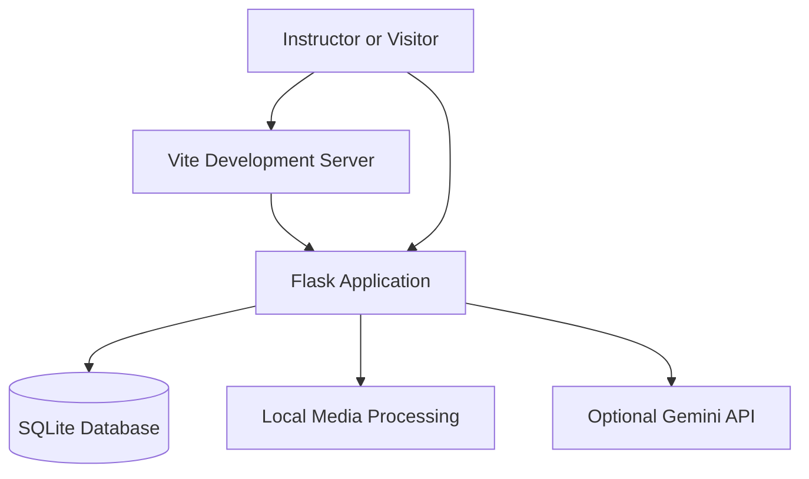

# Classroom Insight

### Multimodal Attendance & Engagement Agent

A local-first instructor workspace for roster-based attendance, classroom activity analysis, engagement insights, and evidence-linked teaching suggestions.

[](https://react.dev/)
[](https://www.typescriptlang.org/)
[](https://vite.dev/)
[](https://flask.palletsprojects.com/)
[](https://sqlite.org/)

Classroom Insight combines a modern instructor dashboard with local data persistence, video and audio signal analysis, attendance tracking, reporting, and optional Gemini-powered recommendations.

It is designed as a **single-instructor local demonstration**, not a hosted, multi-tenant institutional service.

## Contents

- [Features](#features)
- [Product screenshots](#product-screenshots)
- [Technology stack](#technology-stack)
- [Architecture](#architecture)
- [Getting started](#getting-started)
- [Demo walkthrough](#demo-walkthrough)
- [Attendance and engagement methodology](#attendance-and-engagement-methodology)
- [Media analysis](#media-analysis)
- [AI capabilities](#ai-capabilities)
- [Testing and verification](#testing-and-verification)
- [Privacy and security](#privacy-and-security)
- [Known limitations](#known-limitations)
- [Documentation](#documentation)

## Features

### Instructor workspace

- **Overview dashboard** — classroom summaries, key metrics, and trends.
- **Attendance management** — session rosters, attendance confirmation, and historical records.
- **Session management** — create and manage classroom sessions and associated analyses.
- **Engagement analytics** — visualize observable signals and session-level trends.
- **Teaching recommendations** — evidence-linked suggestions with a deterministic local fallback.
- **Student management** — manage students and review their session histories.
- **Reports and exports** — inspect and export available classroom information.
- **Settings** — configure available options and manage sample data and media retention.

### Public institutional website

The public homepage introduces the product and provides navigation to its main sections. It uses locally bundled DM Serif Display and Manrope fonts, an ivory-and-forest-green palette, a custom SVG brand mark, and an illustrative product preview.

The homepage includes:

- Product and workflow explanations.
- Illustrative seminar and workshop examples.
- Employee Login.
- A multi-stage consultation request form.
- An Institution Readiness Brief powered by an optional Gemini API connection.

Illustrative examples are explicitly labelled. They are not presented as live classroom observations or measured outcomes.

### Local data and media processing

- SQLite-backed persistence.
- Session-specific attendance records and historical roster snapshots.
- Video and audio signal analysis using available local processing libraries.
- Synthetic sample data for demonstrations.
- CSV, JSON, and PDF exports where supported.
- Optional AI-generated teaching suggestions and institutional readiness guidance.

## Product screenshots

Screenshots should be genuine captures of the running application. The following paths assume the corresponding PNG files have been saved and verified in `docs/screenshots/`.

### Public website

| Screen | Screenshot |
|---|---|
| Homepage | `docs/screenshots/public-homepage.png` |
| Employee Login | `docs/screenshots/employee-login.png` |
| Consultation Form | `docs/screenshots/consultation-form.png` |

### Instructor dashboard

| Screen | Screenshot |
|---|---|
| Dashboard Overview | `docs/screenshots/dashboard.png` |
| Attendance | `docs/screenshots/attendance.png` |
| Sessions | `docs/screenshots/sessions.png` |
| Engagement Analytics | `docs/screenshots/engagement-analytics.png` |
| Recommendations | `docs/screenshots/recommendations.png` |
| Students | `docs/screenshots/students.png` |
| Reports | `docs/screenshots/reports.png` |
| Settings | `docs/screenshots/settings.png` |

See the [screenshot guide](docs/screenshots/README.md) for capture instructions and privacy checks.

## Technology stack

| Layer | Technologies |
|---|---|
| Frontend | React, TypeScript, Vite |
| Styling and UI | Tailwind CSS v4, Lucide React, Recharts, React Router |
| Backend | Python, Flask |
| Database | SQLite |
| Media processing | OpenCV, NumPy, optional FFmpeg |
| AI integration | Official `google-genai` Python SDK |
| Validation | Pydantic, frontend and backend tests |

Dependency versions and supported ranges are recorded in the npm lockfile and Python requirements files.

## Architecture

The application has two main execution modes:

1. **Development:** Vite serves the frontend and proxies `/api` requests to Flask.
2. **Local production-style mode:** Flask serves the built frontend and the API from the same origin.

The database and media files are stored locally. Optional Gemini requests are sent through the Flask backend; the API key must never be placed in frontend code.



The public homepage is available at `/`, and the operational workspace is under `/app`. Dashboard APIs and operational routes require demo access.

See [ARCHITECTURE.md](docs/ARCHITECTURE.md) for the implementation diagrams, request flows, and database relationships.

## Getting started

### Prerequisites

- Node.js 22.12 or later; Node.js 26 was used for verification.
- Python 3.10 or later; Python 3.13 was used for verification.
- Windows PowerShell for the commands below.

### 1. Open the project

```powershell
cd D:\Coding\classroom-insight
```

### 2. Set up the Python environment

Run these commands from the project root:

```powershell
python -m venv .venv
.\.venv\Scripts\python.exe -m pip install -r requirements.txt
```

Create `.env` only if it does not already exist:

```powershell
Copy-Item .env.example .env
```

Configure a strong, random `FLASK_SECRET_KEY` in `.env`. Gemini configuration is optional.

**Do not overwrite an existing `.env` file**, and never commit API keys or secrets to Git.

### 3. Start the backend

In the first PowerShell terminal:

```powershell
cd D:\Coding\classroom-insight
.\.venv\Scripts\python.exe -m backend.app
```

Keep this terminal running.

### 4. Start the frontend

Open a second terminal:

```powershell
cd D:\Coding\SkillWallet\Multimodal
npm ci
npm run dev
```

Keep this terminal running as well.

### 5. Open the application

- **Development frontend:** http://127.0.0.1:5173/
- **Local Flask application:** http://127.0.0.1:5000/

During development, use the Vite URL. Vite proxies API requests to Flask at `127.0.0.1:5000`.

Do not expose either development server to an untrusted network.

### Optional: Run the built application

After building the frontend:

```powershell
npm run build
```

The project also supports serving the built SPA through Waitress:

```powershell
.\.venv\Scripts\waitress-serve.exe --listen=127.0.0.1:5000 --threads=4 --call backend.app:create_app
```

Use only one application process because analysis-job concurrency is process-local. This is a local serving option, not a production security certification.

## Demo walkthrough

### Employee Login

The application includes a deliberately public demonstration account.

| Field | Demo value |
|---|---|
| Email | `instructor@classroom.demo` |
| Password | `ClassroomDemo!2026` |

These are demonstration credentials, not real employee accounts.

The server stores a hash of an opaque session token in SQLite and issues an HttpOnly, SameSite=Strict cookie. Normal sessions expire after eight hours; Remember me enables a seven-day persistent cookie. The dashboard displays a Demo Mode indicator.

Sign Out revokes the server-side token, clears the cookie, and returns the user to the public homepage.

This mechanism is intended for demonstration only. It does not provide institutional identity management, role-based access, or tenant isolation.

### Explore sample data

1. Open the homepage and choose **Employee Login**.
2. Sign in using the demo credentials.
3. Choose **Explore sample data** on Overview or use Settings → **Load sample data**.
4. Explore the eight operational sections.
5. Inspect attendance, session histories, analytics, recommendations, and exports.
6. Use Settings → **Reset sample data** if you want to remove the sample records after confirmation.

The sample dataset contains six fictional sessions and twelve fictional students. Loading it repeatedly is designed to be safe.

Sample students do not automatically enter real session rosters. Uploaded media cannot be attached to sample sessions.

The initial workspace is empty until data is explicitly created or loaded.

### Request a Consultation

The consultation form has four stages: contact, organization, requirements, and review.

- Phone and contact consent are optional.
- Consent starts unchecked.
- Browser and backend validation are applied.
- An idempotency key helps prevent duplicate records on retries.
- Successful submissions receive a server-generated `CI-…` reference.

Consultation requests persist in the `institutional_enquiries` table in `data/classroom.sqlite3`.

**The form does not send email.** Production notifications require a separately configured service.

To inspect enquiry metadata without printing contact details:

```powershell
.\.venv\Scripts\python.exe scripts/inspect_enquiries.py
```

To inspect a particular reference:

```powershell
.\.venv\Scripts\python.exe scripts/inspect_enquiries.py --reference CI-REPLACE_WITH_REFERENCE
```

The enquiry database is not cleared when sample classroom data is reset.

### Institution Readiness Brief

The readiness form accepts institution type, workflow goals, requirements, and deployment preferences.

Choose **Use sample information** to populate fictional inputs, then choose **Generate Brief** to explicitly request a Gemini-generated result through Flask.

The backend:

1. Uses `backend/capabilities.json` as the maintained capability catalogue.
2. Maps model-selected capability IDs to server-maintained descriptions.
3. Adds known limitations and validates the result using Pydantic.
4. Checks response structure and length bounds.

Generated results are labelled **Generated by Gemini · advisory**.

If configuration, model access, quota, or response validation fails, the interface should present an explicit error and retry option rather than claiming that static text is an AI-generated result.

Avoid entering personal or confidential information. The readiness workflow is not an automated anonymization service.

## Attendance and engagement methodology

### Attendance

Attendance rates are calculated as confirmed-present entries divided by all roster entries, including unconfirmed entries.

Aggregate rates use student-session entries rather than unique students. Historical rosters are stored as snapshots.

Anonymous person detection does not automatically mark attendance.

### Engagement

The system analyzes available observable signals and presents session-level metrics and trends. Camera movement, occlusion, lighting, and audio quality can affect results.

These signals are imperfect proxies and should not be interpreted as definitive measurements of attention, learning, or student intent.

The system does not implement facial identification, emotion detection, covert recording, or individual attention scoring.

## Media analysis

### Recording limits and formats

- Maximum file size: **100 MB**.
- Maximum duration: **two hours**.
- Maximum sampled video frames: **360 per recording**.
- One active analysis job at a time.

Video formats include MP4, MOV, AVI, WebM, and MKV, subject to installed OpenCV codec support.

PCM WAV audio with supported integer sample widths can be processed directly. MP3, M4A, FLAC, OGG, and audio extraction from video require optional FFmpeg on `PATH`.

Restart Flask after installing FFmpeg. Unsupported formats should fail explicitly; if video audio extraction is unavailable, video results can remain available.

### Person estimates

The bundled OpenCV HOG/SVM pedestrian detector provides rough person estimates without downloading a separate model.

It is poorly suited to seated, occluded classroom subjects and is **not a reliable classroom headcount**. Disable it when only scene-change analysis is desired.

### Scene-change analysis

Scene change is estimated from the mean absolute grayscale difference between sampled frames, expressed as a percentage of the intensity range.

The first sample has no previous frame, so its difference is null. Camera movement and lighting changes can influence the result.

### Audio analysis

Audio processing calculates one-second RMS energy windows and an adaptive activity threshold:

`max(0.015, 2 × 20th-percentile RMS)`

It produces sound-active intervals and a duration fraction. Charts are downsampled to at most 360 points.

This is **not speech recognition, transcription, or speaker attribution**.

### Jobs and retention

Analysis progress is polled while jobs run. Jobs interrupted by a backend restart are marked failed; delete and upload again to retry.

Settings can delete original media while retaining derived metrics. Sessions can delete the full analysis or the complete session. Media and the database are stored in ignored `data/` and are not served as public files.

## AI capabilities

Gemini integration is optional and server-side.

Configure the following in the root `.env` file:

```dotenv
GEMINI_API_KEY=
GEMINI_MODEL=gemini-2.5-flash
FLASK_SECRET_KEY=replace_with_a_random_secret
```

Restart Flask after configuration changes.

The application distinguishes unconfigured or unverified access from verified model access. A model-access check does not guarantee available generation quota.

For dashboard recommendations, **Use Gemini if available** explicitly sends aggregate counts, attendance totals, and signal summaries. Student names, identifiers, and media are not included in that request. The backend validates output and falls back to local rules on failures.

No cloud request occurs merely because the dashboard renders.

AI-generated content is advisory and can be inaccurate. Verify recommendations before using them to make educational decisions.

To explicitly run the readiness verification using fictional workflow information:

```powershell
.\.venv\Scripts\python.exe scripts/verify_readiness.py
```

This uses configured Gemini quota and saves the validated result to ignored `data/verification/readiness-real.json`.

## Tests and verification

Run the Python tests:

```powershell
.\.venv\Scripts\python.exe -m pytest -q
```

Run the frontend tests:

```powershell
npm test
```

Build the frontend:

```powershell
npm run build
```

For synthetic media generation and a live HTTP smoke test, start Flask first:

```powershell
.\.venv\Scripts\python.exe scripts/generate_test_media.py
.\.venv\Scripts\python.exe scripts/http_smoke.py
```

For portal and authentication flows:

```powershell
.\.venv\Scripts\python.exe scripts/portal_smoke.py
```

The portal smoke test checks SPA routes, the Vite proxy, demo login, dashboard APIs, SQLite persistence, duplicate request handling, and sign-out. It keeps one clearly synthetic institutional enquiry for evaluator inspection and reuses its idempotency key on reruns.

The smoke test does not send email or call Gemini.

Automated tests and HTTP checks do not replace real-browser visual testing, real-world media validation, or measured accuracy and performance benchmarks. Consult the [verification record](docs/VERIFICATION.md) for the exact verification evidence and remaining limitations.

## Privacy and security

Classroom Insight is designed for a trusted, single-user local computer.

- The database and media remain in local application storage.
- Operational routes require demo access.
- Media files are not served as public static assets.
- Readiness requests send user-entered workflow information to Gemini only when generation is explicitly requested.
- Dashboard Gemini recommendations use aggregate summaries rather than student names, identifiers, or media.
- Exported CSV, JSON, and PDF files may contain student information.
- Institutional enquiries contain contact details and require an appropriate retention and access policy.
- Retention is manual rather than automatic.

The application uses local Host/Origin validation on writes and bounded public inputs, with persisted local rate limits. These measures are not distributed abuse protection.

### Deployment boundary

The application is **not ready for public or multi-user deployment**.

Before deployment, it would require, at minimum:

- Real authentication and institutional authorization.
- Role and tenant isolation.
- Proper HTTPS and production cookie configuration.
- Isolated media-processing workers and resource quotas.
- Managed backups and a defined retention policy.
- A privacy and security review.

The SQLite database is not encrypted by the application. Native media decoders process untrusted files; use consented media from trusted sources. No compliance certification, hosted delivery, or external integrations are claimed.

## Known limitations

- Demo authentication is not suitable for production accounts.
- FFmpeg is optional; some audio formats and video audio extraction depend on it.
- OpenCV person estimates can be inaccurate in classroom environments.
- Audio energy analysis does not recognize speech or identify speakers.
- Camera and environmental changes can confound engagement signals.
- Gemini availability and generation quota depend on external service access.
- Consultation submissions do not trigger email notifications.
- Browser automation was unavailable during the final documentation phase, so native modal keyboard behavior and full visual responsiveness still require manual verification.
- Measured real-world attendance accuracy and engagement validity have not been established by synthetic tests alone.

## Documentation

- [Project report](docs/PROJECT_REPORT.md)
- [Implementation architecture and database relationships](docs/ARCHITECTURE.md)
- [REST API reference](docs/API.md)
- [Screenshot guide](docs/SCREENSHOTS.md)
- [Screenshot index and capture instructions](docs/screenshots/README.md)
- [Verification record](docs/VERIFICATION.md)

## Project status

Classroom Insight provides a local instructor workspace with attendance management, analytics, reports, media signal analysis, and optional AI-assisted guidance.

Its current scope is a **local demonstration and evaluation project**. The limitations above should be considered before interpreting its signals as reliable educational measurements or using it with real institutional data.