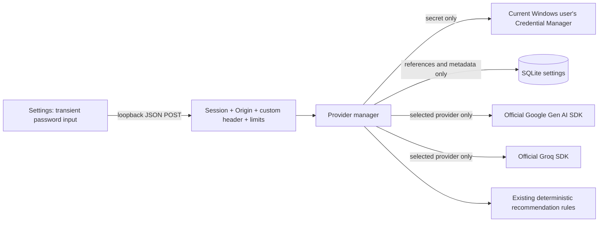

# AI provider security — 30 October 2026

## Scope and threat model

This is a loopback-only, single Windows-user application, not a multi-user secret-management service. The existing employee login is explicitly demo authentication with documented credentials. It is an access gate, not protection against another program running as the same Windows user. Local malware, a compromised browser extension, an XSS vulnerability, an administrator, or another process with that user's vault access remain outside this boundary. Do not expose these services through a tunnel or public reverse proxy.

The controls defend against accidental plaintext credential storage, returned credentials, unsolicited cross-site settings changes, stale UI verification, and unintended cloud-provider selection. They do not guarantee provider availability, protect secrets from an already compromised host, or provide institutional compliance certification.

## Storage architecture

`backend/providers.py` explicitly instantiates `keyring.backends.Windows.WinVaultKeyring`. It does not honor plaintext/chained third-party keyring backends and does not use `keyrings.alt`. Unsupported systems, missing SDKs and vault failures return safe errors; there is no plaintext fallback for Settings-managed keys.

Vault services are `ClassroomInsight/<gemini|groq>/<random-version-id>`, with the fixed account identifier `api-key`. Separate provider/version IDs avoid accidental overwrite. The current Windows user owns the vault entries. SQLite's existing `settings` table contains one `ai_provider_manager` JSON row: active provider, revision, model names, random credential references, environment-fallback policy, verification status/timestamps and fixed safe diagnostics. It never contains the API key or a key suffix. The API returns the fixed mask `••••••••`, not the original credential. Analysis preferences filter out this metadata row. No schema migration was required.

## Credential lifecycle

1. Enter a key into an empty password input. Show/hide applies only before saving. The browser must hold the entered value briefly to send it to Flask; it is never put in web storage or returned by the server.
2. Save writes a new, random vault entry and reads it back before committing its reference. Only then is the previous vault version retired. Failed writes or database commits leave the previous reference/key in place; a newly staged entry is cleaned up where possible.
3. Saving/replacing a key resets its verification but does not enable its provider. The input is cleared and masked after success. No `.env` key is automatically copied into the vault.
4. Deletion requires the confirmation dialog and backend `{ "confirm": true }`. It removes the referenced vault credential, disables that provider if active, and sets an environment-fallback tombstone so a deleted key is not silently replaced by `.env`. The `.env` file itself is never edited. Saving a new key configures the provider again.
5. SQLite and Credential Manager cannot share one transaction. Deletion has a compensating restore if the database commit fails. A power loss or a simultaneous vault failure can still require manual reconciliation. A failed obsolete-version cleanup logs only a fixed maintenance notice; review `ClassroomInsight/` entries in Windows Credential Manager if that occurs. Unreferenced entries are never used automatically.

## Selection, generation and verification

- One authoritative `active` value is `gemini`, `groq`, or null. Changes use `BEGIN IMMEDIATE` and a single metadata row. Concurrent switches cannot produce two active providers. Switching never removes the inactive provider's credential.
- Activation requires an available credential. It does not claim generation compatibility: test explicitly. A Groq model is not guessed; save a key, discover account models, choose a text model with JSON support, save the model, then test.
- `GeminiProvider` uses the official Google SDK and the existing default `gemini-2.5-flash`, confirms generation support and parses JSON. `GroqProvider` uses the official Groq SDK, checks the selected model against the authenticated account model list, and parses JSON output. A successful model lookup alone never verifies a provider.
- Testing sends only a fixed connection prompt and requires exactly `{"status":"ok"}` as the parsed result. It works while inactive but does not activate the provider. Both cloud providers can have successful historical verification, but only one can be active.
- Metadata includes the last attempt and last successful verification. Success is a point-in-time result, not a continuing quota guarantee. Replacing a key or changing a model resets it. Vault-managed metadata persists across restart. Environment verification resets after restart because deployment values may have changed; the historical success timestamp is retained.
- Persistent revisions order frontend responses. Older GETs cannot replace newer POST results. Verification that races a configuration change returns 409 rather than marking the replacement configuration verified.
- Recommendations and institutional readiness use `cloud_json` and the single selected provider. The compatibility request field `use_gemini` now means “use the selected cloud provider if available.” Recommendations use existing deterministic local rules when cloud use is not requested, no provider is active, or generation/validation fails. They label the actual source as `local`, `gemini`, or `groq`; they never silently switch between cloud vendors.
- The readiness brief needs cloud synthesis. With both providers off or on failure it gives a safe unavailable message, not fabricated local AI output. Attendance, media analysis, fusion and reports continue locally.

## HTTP protections

- Vite and Flask commands bind to `127.0.0.1`; Flask rejects non-local Host values. No wildcard CORS is configured.
- All `/api/settings/ai` endpoints require the existing HTTP-only, SameSite=Strict demo session cookie. Mutations additionally require an allowed local Origin, `X-Classroom-Settings: 1`, JSON content type and at most 2,048 bytes. Cross-site Fetch Metadata is rejected by the existing app guard. The custom header plus exact Origin validation is the CSRF defense; the header is not an authentication secret.
- Provider IDs, keys, model IDs, booleans, object shape and deletion consent are validated. API responses are `no-store` and return only allowlisted metadata and categorized errors. No provider raw exceptions, authorization headers or complete SDK configurations are logged or returned.
- Settings mutations are limited to 30/minute; model discovery and verification share 6/minute for this local installation. The legacy explicit Gemini probe shares the verification limit. Limits use the existing SQLite rate-limit table; they are not tenant quotas.
- Requests have bounded timeouts; Groq automatic retries are disabled. TLS verification remains enabled in the SDKs. No private classroom media or student identifiers are sent by connection tests.

## Environment transition

The root `.env` remains loaded with deployment values taking precedence. `GEMINI_API_KEY` / `GOOGLE_API_KEY` remain optional development aliases; `GROQ_API_KEY` / `GROQ_MODEL` are optional development values. Before any manager selection has been saved, an existing Gemini environment key preserves the earlier Gemini-enabled development workflow. Explicitly disabling both providers persists local mode across restarts.

To transition: enter your key yourself in Settings, Save key, Test connection, then Enable the desired provider. A saved vault reference always takes precedence; if its vault entry becomes unavailable, the application fails closed rather than reverting to `.env`. After verifying the vault workflow, you may manually remove environment-key dependence and restart Flask. This implementation does not edit `.env`. Never paste keys into chat, screenshots, issue reports or terminal output.

## Verification evidence and boundaries

- `tests/test_providers.py`: mock-vault and mock-SDK coverage for save/replace/delete, database rollback, vault failures, missing entries, masking, no response/log/SQLite leakage, environment precedence/tombstones, restart persistence, concurrent authenticated switching, CSRF, size limits, rate limits, both SDK generation contracts, invalid JSON, local fallback and source attribution.
- `src/gemini.test.tsx`: rendered React tests for successful/failed verification surviving stale refresh/remount, error responses, secret-input clearing, show/hide, deletion confirmation/cancel, exclusive switching and activation errors. Existing portal/readiness and operational regressions are retained.
- Real HTTP verification on the isolated QA SQLite snapshot: **30 October 2026, 16:21:01 IST**, Gemini `gemini-2.5-flash`, HTTP 200, `access=verified`; subsequent GET retained it. The fixed prompt was genuinely generated, not mocked.
- Real Windows vault save, read-back, replacement, masking, exclusive switching, both-off mode and confirmed deletion passed using fictional test keys. An actual invalid-key provider request returned a safe failed status. Test vault entries were removed; the environment key was not migrated.
- Groq real generation: **not run**, no Groq credential or model was configured. SDK behavior is covered by mocks, not a claim of real account access.
- New Settings browser verification: **blocked**. The browser tool returned “Local browser use is disabled in Work settings.” This phase has no new browser-click or visual verification claim. Earlier Gemini-only browser evidence is historical and does not verify these new controls.

## Before multi-user deployment

Replace demo login with real authentication and per-user/admin authorization, use HTTPS and deployment-specific trusted origins, introduce tenant-scoped secrets in an audited server-side secret manager, enforce per-user quotas and access logs, and review CSP/XSS protections. Do not use the server process's Windows vault as a shared-user credential boundary. Add recovery/reconciliation for cross-store crashes, review consent and retention, test with real Groq account access, and complete desktop/mobile keyboard and browser checks. A database backup alone does not contain the vault credentials and cannot restore them on another Windows account.

## References

- [keyring documentation](https://keyring.readthedocs.io/en/stable/)
- [Windows WinVaultKeyring implementation](https://github.com/jaraco/keyring/blob/main/keyring/backends/Windows.py)
- [Official Groq Python SDK](https://github.com/groq/groq-python)
- [Groq chat API and model requirements](https://console.groq.com/docs/api-reference)

### Final checks for the provider-manager phase

Executed from `D:\Coding\classroom-insight` on 30 October 2026:

- `$env:PYTEST_DISABLE_PLUGIN_AUTOLOAD='1'; .\.venv\Scripts\python.exe -B -m pytest -p no:cacheprovider --basetemp=data/provider-tests-04 -q` — **112 passed in 16.40s**.
- `npm test -- --maxWorkers=1` — **51 passed, 6 files**.
- `node node_modules/typescript/bin/tsc --noEmit --incremental false -p tsconfig.json` — passed.
- `npm run build` — passed, 2,635 modules transformed.
- `.\.venv\Scripts\python.exe -m pip check` — no broken requirements.
- `.\.venv\Scripts\python.exe -B scripts/verify_provider_manager.py --qa-database-confirmed` — real HTTP Gemini generation and real Windows vault lifecycle passed on the disposable QA snapshot. This script must never target an existing production database; it does not migrate the environment key.
- `git diff --check` — passed (Git emitted line-ending normalization warnings). Configured secret-value scan of changed/untracked files and built assets passed. Original eleven table fingerprints and `.env` hash matched the baseline. No migration, reset, reseed, commit or push.
- Browser interaction: not executed after access denial. Groq genuine generation: not executed without credentials/model. Neither is counted as passed.

Files changed in this phase (pre-existing unrelated changes retained):

- New: `backend/providers.py`, `src/AIProviders.tsx`, `tests/test_providers.py`, `scripts/verify_provider_manager.py`, `docs/AI_PROVIDER_SECURITY.md`.
- Updated backend: `backend/app.py`, `backend/db.py`, `backend/portal.py`, `backend/readiness.py`, `backend/recommendations.py`.
- Updated frontend/tests: `src/pages.tsx`, `src/public/PublicHome.tsx`, `src/public/Readiness.tsx`, `src/App.test.tsx`, `src/gemini.test.tsx`, `tests/test_portal.py`.
- Updated dependencies/scripts: `requirements.txt`, `requirements.lock.txt`, `scripts/verify_readiness.py`.
- Updated documentation: `README.md`, `docs/API.md`, `docs/ARCHITECTURE.md`, `docs/REQUIREMENTS_AUDIT.md`, `docs/SUBMISSION_STATUS.md`.
