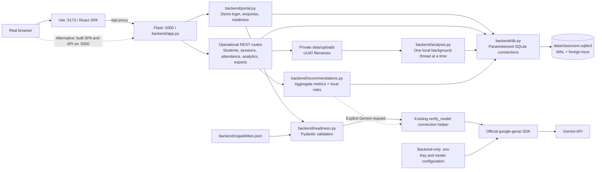
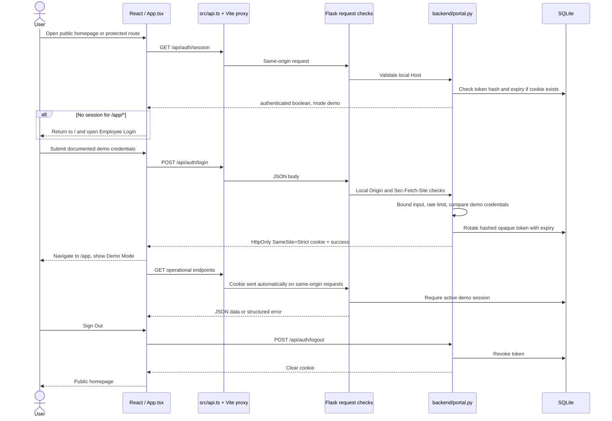
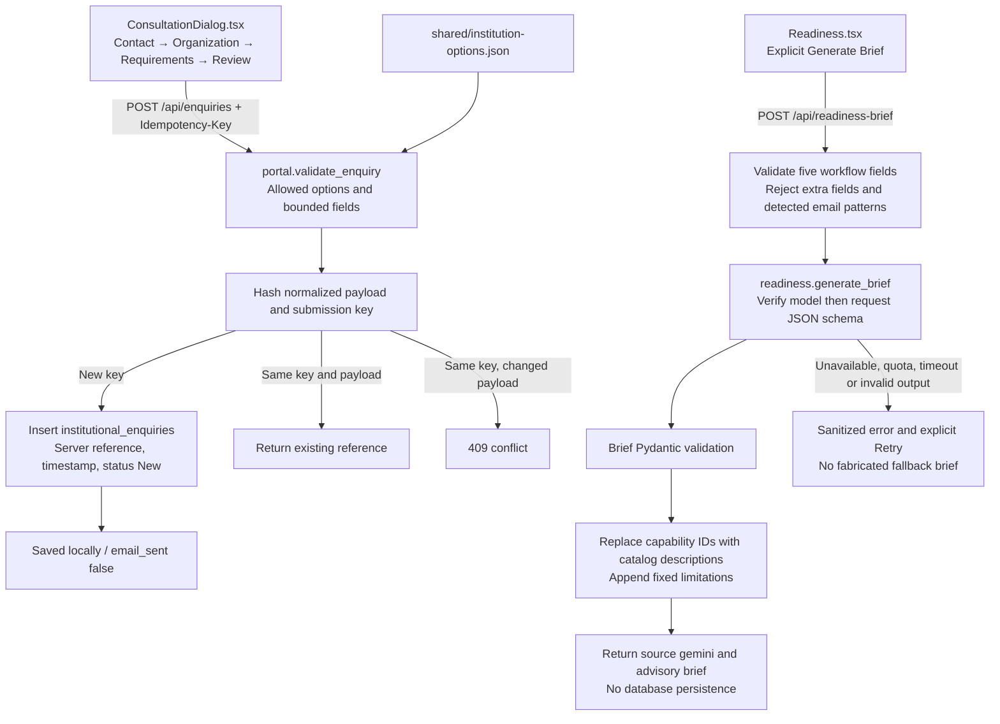
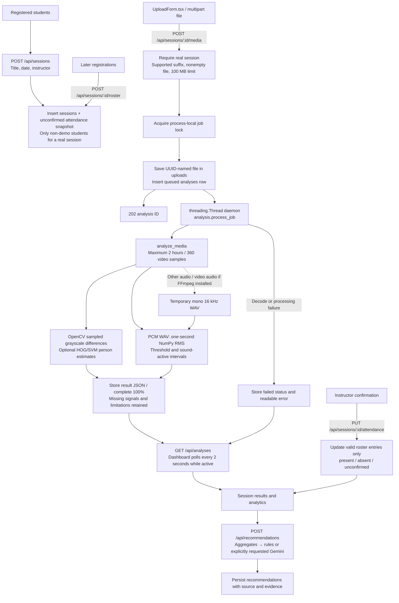

# Classroom Insight architecture

Source inspection: 29 October 2026. This describes the existing local implementation, not proposed enterprise services. See [API contracts](API.md), [verification evidence](VERIFICATION.md) and [screenshot capture status](screenshots/README.md).

## Overall system

- `src/main.tsx` mounts React and BrowserRouter. `src/App.tsx` separates the public `/` route from guarded `/app/*`; old dashboard paths redirect under `/app`, preserving query strings.
- `src/public/` owns the homepage, illustrative product visuals, login/consultation modals and readiness form. Example switching is local and never calls Gemini.
- `src/Dashboard.tsx` loads shared operational state through `src/api.ts` and exposes it through `src/data.tsx`. `src/pages.tsx` contains the eight screens. `src/ChartView.tsx` lazy-loads Recharts components from `src/charts.tsx`.
- `src/ui.tsx` provides shared buttons, alerts and native dialogs. Fonts are bundled locally; Tailwind v4 tokens are in `src/styles.css`, with editorial layouts in `src/public/public.css`.
- `vite.config.ts` proxies `/api` to port 5000. After a build, Flask's SPA fallback serves `dist/index.html` for frontend deep links and serves existing assets from `dist`. Unknown `/api/*` paths return JSON errors rather than the SPA shell.
- No database or Gemini access runs in the frontend. Uploaded media is not exposed through a public file route. There is no email delivery service, institution account system or integration platform.

## Frontend-to-backend request flow

`src/api.ts` converts JSON errors into `ApiError`, including field-level validation details. A `demo_session_required` error dispatches an event that returns the UI to login. Flask disables API response caching and sends nosniff, no-referrer and frame-denial headers. Write requests reject foreign origins and cross-site fetch metadata; the deployment remains loopback-only.

The token is stored as a SHA-256 hash, not as a plaintext password. Normal demo sessions expire after eight hours; Remember me uses seven days and a persistent cookie. Cookie Secure defaults false for local HTTP. All demo users share the same local records; this is **not** institutional authentication or tenant isolation.

### Two separate public workflows

Contact details from enquiries are not attached to readiness requests. Readiness does not read stored student/session records or media. The email-pattern check is not a complete anonymization service. Local teaching recommendations have a separate deterministic fallback; readiness errors do not display that fallback as AI output. No public enquiry list/detail endpoint exists.

## Session and media-analysis flow

Analysis never updates attendance. HOG counts cannot identify students; audio energy is not speech attribution. A successful video analysis can retain unavailable-audio notes. Temporary extracted WAV files are removed after analysis. The original upload remains until explicit deletion.

`init_db` marks previously queued/processing rows failed when an application process starts, because jobs are not durable. In tests, the worker executes synchronously. In normal operation, one daemon thread and an in-process lock provide local concurrency control; there is no external queue or distributed worker. Run one application process.

`GET /api/analytics` filters session/date ranges and uses each session's latest completed analysis. Attendance rate divides confirmed-present entries by all roster entries, including unconfirmed. `GET /api/export/attendance.csv` exports records with formula-safe cell handling. Session JSON and browser print/PDF reports are assembled by the frontend.

## Actual SQLite schema

The following diagram includes every application table declared in `backend/db.py`. JSON is stored in SQLite `TEXT` columns. Lines represent actual foreign keys only.

```mermaid
erDiagram
    students ||--o{ attendance : "student_id / CASCADE"
    sessions ||--o{ attendance : "session_id / CASCADE"
    sessions ||--o{ analyses : "session_id / CASCADE"
    sessions ||--o{ recommendations : "session_id / CASCADE"

    students {
        INTEGER id PK
        TEXT identifier UK "NOT NULL; COLLATE NOCASE"
        TEXT name "NOT NULL"
        TEXT cohort "NOT NULL; default empty"
        INTEGER is_demo "NOT NULL; default 0"
    }
    sessions {
        INTEGER id PK
        TEXT title "NOT NULL"
        TEXT date "NOT NULL; ISO date validated by API"
        TEXT instructor "NOT NULL"
        INTEGER is_demo "NOT NULL; default 0"
        TEXT created_at "NOT NULL"
    }
    attendance {
        INTEGER session_id PK,FK "NOT NULL; composite key"
        INTEGER student_id PK,FK "NOT NULL; composite key"
        TEXT status "NOT NULL; present absent unconfirmed"
    }
    analyses {
        INTEGER id PK
        INTEGER session_id FK "NOT NULL"
        TEXT filename "NOT NULL"
        TEXT stored_name "Nullable after original-media deletion"
        TEXT status "NOT NULL"
        INTEGER progress "NOT NULL; default 0"
        TEXT result "Nullable JSON"
        TEXT error "Nullable"
        INTEGER is_demo "NOT NULL; default 0"
        TEXT created_at "NOT NULL"
    }
    recommendations {
        INTEGER id PK
        INTEGER session_id FK "NOT NULL"
        TEXT source "NOT NULL"
        TEXT items "NOT NULL; JSON"
        TEXT note "Nullable"
        TEXT created_at "NOT NULL"
    }
    settings {
        TEXT key PK
        TEXT value "NOT NULL; JSON"
    }
    events {
        INTEGER id PK
        TEXT message "NOT NULL"
        TEXT created_at "NOT NULL"
        INTEGER is_demo "NOT NULL; default 0"
    }
    demo_sessions {
        TEXT token_hash PK
        INTEGER expires_at "NOT NULL; Unix seconds"
        TEXT created_at "NOT NULL"
    }
    institutional_enquiries {
        INTEGER id PK
        TEXT reference UK "NOT NULL; server-generated"
        TEXT created_at "NOT NULL"
        TEXT idempotency_hash UK "NOT NULL"
        TEXT payload_hash "NOT NULL"
        TEXT contact_name "NOT NULL"
        TEXT work_email "NOT NULL"
        TEXT organization_name "NOT NULL"
        TEXT details "NOT NULL; full validated JSON"
        INTEGER consent "NOT NULL; 0 or 1"
        TEXT status "NOT NULL; New Reviewed Closed; default New"
    }
    public_rate_limits {
        TEXT scope PK "NOT NULL; composite key"
        INTEGER window PK "NOT NULL; composite key"
        INTEGER hits "NOT NULL"
    }
```

`settings`, `events`, `demo_sessions`, `institutional_enquiries` and `public_rate_limits` have no declared foreign-key relationships. There is no employee/user table and no relationship between demo sessions and student identities. Recommendations relate to a session, not to an analysis row; deleting an entire analysis explicitly removes that session's saved recommendations in application code. Deleting original media only retains measurements. Deleting a session removes its files through application code and cascades its dependent rows through SQLite.

Connections enable foreign keys and use a 15-second SQLite timeout. Initialization uses `CREATE TABLE IF NOT EXISTS` and WAL mode. No migration framework or automatically enforced retention policy exists. Database files, originals, secrets and generated private artifacts are excluded from Git; shared example data is explicitly labelled.

## Deployment boundary

Current host/origin restrictions, local rate counters and demonstration cookies are appropriate only to the documented local evaluation workflow. Real institutional use requires real identities/roles, tenant isolation, HTTPS, retention and consent policy, encrypted/managed backups, notification configuration, isolated decoder jobs, deployment monitoring and independent security/privacy review. The repository does not establish these services or regulatory compliance.
