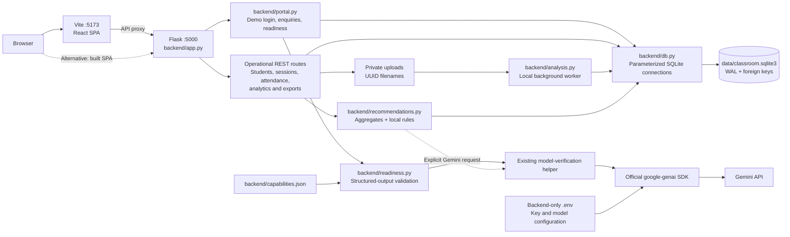
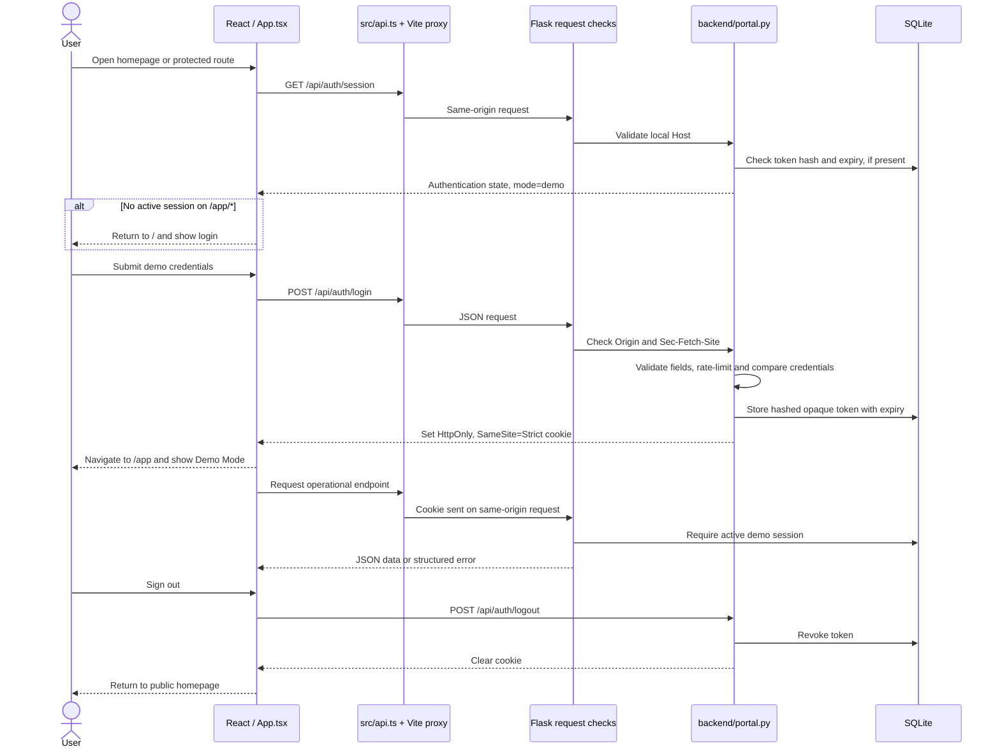
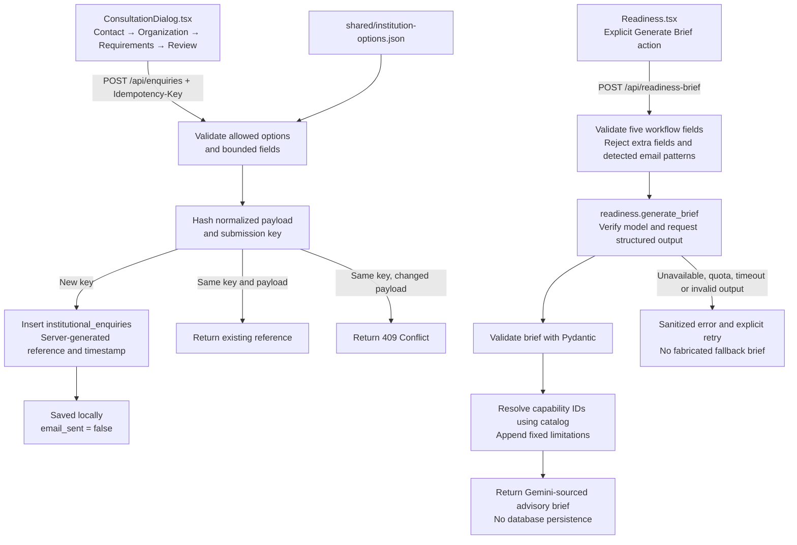
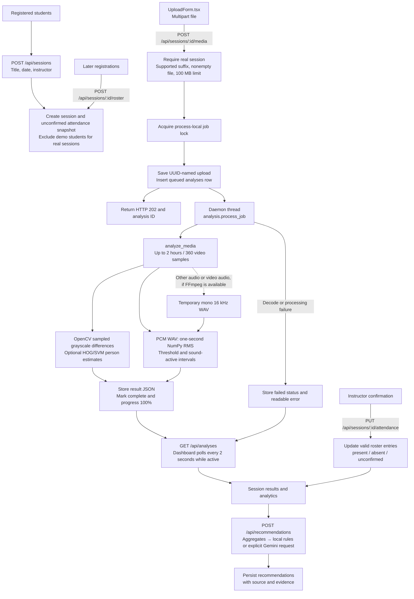
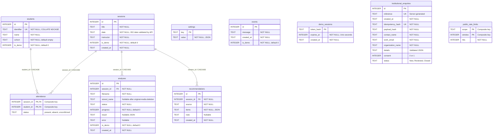

# Classroom Insight — Architecture

**Source inspection:** 29 October 2026

This document describes the existing local implementation, not proposed enterprise infrastructure.

Related documentation:
- [API contracts](API.md)
- [Verification evidence](VERIFICATION.md)
- [Screenshot inventory and capture status](SCREENSHOTS.md)
- [Project report](PROJECT_REPORT.md)
- [Final-phase implementation map](FINAL_PHASE_FILES.md)

## 1. System overview

### Main components

- **Application entry and routing:** `src/main.tsx` mounts React and `BrowserRouter`. `src/App.tsx` separates the public `/` route from guarded `/app/*` routes. Legacy dashboard paths redirect under `/app`, preserving query strings.
- **Public experience:** `src/public/` contains the homepage, illustrative product visuals, login and consultation dialogs, and the readiness form. Switching between example readiness results is local and does not call Gemini.
- **Dashboard:** `src/Dashboard.tsx` loads shared operational state through `src/api.ts` and exposes it through `src/data.tsx`. `src/pages.tsx` contains the eight dashboard screens.
- **Charts:** `src/ChartView.tsx` lazy-loads Recharts components from `src/charts.tsx`.
- **Shared UI:** `src/ui.tsx` provides reusable controls and dialogs. Fonts are bundled locally. Tailwind v4 tokens are defined in `src/styles.css`, with public-page layouts in `src/public/public.css`.
- **Development and production serving:** `vite.config.ts` proxies `/api` requests to port 5000. After a frontend build, Flask's SPA fallback serves `dist/index.html` for frontend deep links and serves existing build assets. Unknown `/api/*` paths return JSON errors instead of the SPA shell.
- **External services:** The frontend does not access SQLite or Gemini directly. Uploaded media is not exposed through a public file-serving route. There is no configured email-delivery service, institutional account system, or integration platform.

## 2. Frontend-to-backend request flow

`src/api.ts` converts JSON API errors into `ApiError` instances, including field-level validation details. A `demo_session_required` error dispatches an event that returns the UI to the login flow.

Flask disables API response caching and sends security headers for MIME-type sniffing, referrer policy, and frame denial. Write requests reject foreign origins and cross-site fetch metadata. The documented deployment is loopback-only.

### Demo-session behavior

- The session token is stored in SQLite as a SHA-256 hash rather than as a plaintext token.
- Normal sessions expire after eight hours. **Remember me** uses a seven-day expiry and persistent cookie.
- The cookie's `Secure` attribute defaults to `false` for local HTTP. HTTPS deployments require appropriate secure-cookie configuration.
- Demo credentials are intentionally public for evaluation.
- Demo users share the same local records. There is no employee identity system, role-based authorization, or tenant isolation.

This is demonstration authentication, not production institutional authentication.

## 3. Public workflows

Consultation enquiries and Institution Readiness Brief generation are separate workflows.

### Consultation enquiries

The consultation form validates its inputs against shared options and bounded field constraints. Submission uses an idempotency key to avoid creating duplicate records on retries. Reusing a key with a different payload returns a conflict.

Successful submissions are stored locally in `institutional_enquiries`, with a server-generated reference, timestamp, and initial status. They are not emailed automatically.

### Institution Readiness Brief

Readiness generation is an explicit user action. The backend validates the workflow inputs, requests structured output from Gemini, validates the response with Pydantic, resolves capability IDs against `backend/capabilities.json`, and appends fixed limitations.

- Contact details from consultation enquiries are not attached to readiness requests.
- Readiness does not read stored student/session records or uploaded media.
- The email-pattern check is not a complete anonymization service.
- Readiness results are not persisted to the database.
- Failures produce sanitized errors and a retry option, not a fabricated AI-generated brief.
- Deterministic teaching recommendations are a separate workflow and must not be presented as a generated readiness brief.

No public enquiry-list or enquiry-detail endpoint is provided.

## 4. Session, media-analysis, and recommendation flow

### Attendance and session records

Creating a session initializes attendance records as unconfirmed. Instructor confirmation updates valid roster entries. Later student registrations can be added to a session's roster.

**Media analysis does not modify attendance.** Analysis results and attendance records remain separate data sources.

### Media processing

The analysis worker uses local processing:

- **Video:** OpenCV samples frames, compares grayscale frames for scene changes, and can use HOG/SVM person estimates.
- **Audio:** NumPy computes one-second RMS energy values from supported PCM WAV input, using a threshold to estimate sound-active intervals.
- **Audio extraction:** Other audio formats and audio embedded in video depend on FFmpeg availability and successful conversion to temporary mono 16 kHz WAV.
- **Results:** Analysis records retain status, progress, output JSON, and readable errors where applicable. Missing signals and limitations can be retained in the result.

HOG/SVM estimates do not identify students. RMS energy is not speech recognition, speaker attribution, or a measure of individual attention. Scene-change and sound-activity signals are heuristics, not validated educational diagnoses.

Temporary extracted WAV files are removed after processing. The original upload remains until explicitly deleted.

### Worker and concurrency constraints

`init_db` marks queued or processing analyses as failed when the application process starts, because background jobs are not durable across restarts.

In normal operation, a daemon thread and process-local lock provide limited concurrency control. Tests can execute the worker synchronously. There is no external job queue, durable worker service, or distributed lock.

**Run a single application process for the documented local workflow.** A multi-process deployment would require different job coordination and recovery behavior.

### Analytics and exports

- `GET /api/analytics` filters by session/date range and uses each session's latest completed analysis.
- Attendance rate divides confirmed-present entries by all roster entries, including unconfirmed entries.
- `GET /api/export/attendance.csv` exports attendance records with formula-safe cell handling.
- Session JSON and browser print/PDF reports are assembled by the frontend.
- Recommendations are generated from aggregates using local rules or an explicitly requested Gemini workflow, then persisted with their source and supporting evidence.

## 5. Actual SQLite schema

The diagram below describes the application tables declared in `backend/db.py`. JSON payloads are stored in SQLite `TEXT` columns. Relationship lines represent declared foreign keys.

### Relationships and persistence behavior

- `attendance` has a composite key using `session_id` and `student_id`.
- `students`, `sessions`, `attendance`, `analyses`, and `recommendations` have the foreign-key relationships shown in the diagram.
- `settings`, `events`, `demo_sessions`, `institutional_enquiries`, and `public_rate_limits` have no declared foreign-key relationships in this schema.
- There is no employee/user table and no relationship between demo sessions and student identities.
- Recommendations reference a session rather than an analysis row. Deleting an analysis can remove that session's saved recommendations through application code.
- Deleting original media retains analysis measurements. Deleting a session removes associated files through application code and cascades dependent rows through SQLite.

Connections enable foreign keys and use a 15-second SQLite timeout. Initialization uses `CREATE TABLE IF NOT EXISTS` and WAL mode. There is no migration framework or automatically enforced retention policy.

Database files, original media, secrets, and generated private artifacts are excluded from Git. Shared example data is explicitly labelled.

## 6. Deployment and trust boundaries

The implementation is intended for local evaluation, not direct institutional deployment.

| Area | Current implementation | Production requirement |
|---|---|---|
| Identity | Public demo credentials | Real identity provider and account lifecycle |
| Authorization | Shared demo session | Roles, permissions, and tenant isolation |
| Transport | Local HTTP supported | HTTPS and secure cookie configuration |
| Persistence | Local SQLite | Managed storage, backup, recovery, and retention policy |
| Media jobs | In-process daemon thread | Isolated, durable job processing |
| Rate limiting | Local SQLite counters | Deployment-appropriate shared rate limiting |
| Notifications | Enquiries stored locally | Explicitly configured and tested delivery service |
| AI integration | Optional Gemini API | Key management, quota controls, monitoring, and data governance |
| Privacy | Documented data boundaries | Institutional consent, access, deletion, and retention policies |
| Measurement validity | Heuristic media signals | Independent validation before operational decisions |

### Security and privacy boundaries

- Keep `.env` and real credentials out of version control.
- Do not expose uploaded media through a public file-serving route.
- Do not treat the demo cookie or shared demo account as institutional authorization.
- Do not treat the email-pattern check as proof that readiness inputs contain no identifying information.
- Review what data is sent to external AI services before enabling Gemini in a real deployment.
- Do not use heuristic classroom-analysis outputs as validated measures of student attention, identity, or educational performance.

Classroom Insight does not, by itself, establish regulatory compliance or production security readiness. Institutional use requires an appropriate authentication and authorization model, secure deployment configuration, a defined data-retention policy, managed backups, monitoring, and independent security and privacy review.