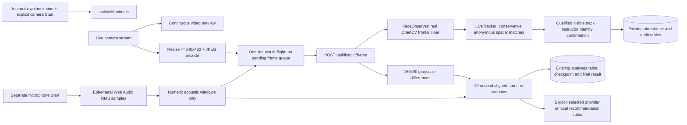

# Continuous live monitoring — 30 October 2026

This extension adds `/app/live` to the existing dashboard. It does not replace attendance, uploads, reports or the Windows-vault AI Provider Manager. The earlier snapshot/WAV dialog remains a separate explicitly retained-recording workflow. No reference screenshot was available to inspect during this phase; the dark forest monitoring workspace uses the existing typography, icons and palette rather than claiming a pixel match.

## Startup repair verification - 30 October 2026

Direct HTTP reproduced POST `/api/live/start` returning **405** on both port 5000 and the Vite proxy at 5173, with body `{"error":{"code":"method_not_allowed","message":"The method is not allowed for the requested URL."}}`. Direct backend OPTIONS advertised `HEAD, OPTIONS, GET`. The source already defined POST; the stale running backend reached the GET-only SPA catch-all. Method, path and proxy target in the frontend were correct. Vite's OPTIONS 204 alone did not establish the backend POST existed.

Stopped only the identified Classroom Insight Flask processes (old port-5000 PID 19236 and second Flask PID 10968), then launched one current backend. Kept Vite and unrelated Python processes. Both ports now return health 200 with `live_monitor.protocol: 1` and unauthenticated live-start POST 401 (`Sign in before live monitoring.`), rather than 405. This verifies routing, not an authenticated hardware run.

Previously the controller acquired a camera, assigned srcObject, called play(), then sent the failing POST. Its error handler released tracks and cleared srcObject, explaining the stopped/black state on that error path. It does not prove hardware works. The repair probes backend compatibility before camera access, waits for current video data/nonzero dimensions, and bounds startup with cleanup. Pending microphone requests are serialized; cancellation invalidates late permission results.

Session selection now starts empty and New session stays available. Read-only inspection found sample sessions 1-6 plus synthetic QA sessions 8/9. No genuine classroom session exists in this database. Neither QA session had attendance rows. No original records were changed or added by this repair; create/select an actual classroom session for hardware monitoring.

Executed verification:

- `$env:PYTEST_DISABLE_PLUGIN_AUTOLOAD='1'; .\.venv\Scripts\python.exe -B -m pytest -q -p no:cacheprovider --basetemp=data/live-repair-full-tests`: **128 passed in 20.34s**, disposable test databases.
- `npm test -- --maxWorkers=1`: **71 passed in 7 files, 26.21s**; devices mocked in jsdom.
- `node node_modules/typescript/bin/tsc --noEmit --incremental false -p tsconfig.json`: passed.
- `npm run build`: passed, 2637 modules.
- `.\.venv\Scripts\python.exe -B scripts/verify_live_monitor.py --qa-database-confirmed`: passed against its isolated QA database and ephemeral server. Start 201; 42 frame POSTs 200; invalid confirmation 400; local suggestions 200; end 200; raw media GET 404. Synthetic blank JPEGs correctly yielded zero tracks; synthetic acoustic metrics produced two aligned windows. HTTP median 12.85ms, p95 35.09ms. This is not real-camera performance or face-accuracy evidence.
- `test_exact_live_start_post_route_and_health_protocol` covers exact POST registration, 401, validation 400, valid start 201 and end. Frontend regressions cover stale-backend rejection before camera access, readiness/timeout, late microphone cancellation and explicit session selection. Existing tests exercise synthetic tracking/presence and provider-manager regressions.
- Every original SQLite table's row fingerprint and .env bytes matched before/after. No vault access/changes, commits or pushes.

Browser verification remains blocked: the tool returned **Local browser use is disabled in Work settings** before opening the page. No browser Network/Console inspection, device enumeration, real preview, real face detection or microphone test is claimed. Local-browser integration permission and website camera/microphone permissions are separate.

Remaining manual check: Ctrl+Shift+R at `http://127.0.0.1:5173/app/live`, sign in, create/select a genuine session, confirm authorization, then Start camera monitoring and allow camera access. Close other camera apps if busy. Start microphone separately and allow permission. Check real preview, frame responses and actual faces; end the session and confirm browser device indicators stop. Never treat synthetic test results as hardware verification.

## How to demonstrate

From `D:\Coding\classroom-insight`, restart the project's Flask process with `.\.venv\Scripts\python.exe -m backend.app`. In another terminal run `npm run dev` (reuse a healthy existing Vite process). Visit `http://127.0.0.1:5173/app/live`, sign in with the documented demo login and select a non-sample session. Register students before creating a session so its roster contains the intended students. Do not use fictional/sample sessions for actual observation data.

1. Explain processing to participants, obtain appropriate authorization, then check the consent box. Set the sampling/presence thresholds if needed.
2. Click **Start camera monitoring** and allow camera access. A continuous `<video>` preview runs locally; sampled JPEGs are sent to Flask for real OpenCV frontal-Haar detection. No fake boxes or students are supplied by the product.
3. Click **Start microphone** separately and allow microphone access. Web Audio computes RMS approximately every 50 ms without audible monitoring. Numeric activity windows are sent with sampled camera frames; raw audio is not transmitted or recorded.
4. Watch anonymous IDs and qualification. Slight movement can preserve an unambiguous spatial match. After sufficient observed time, select **Confirm attendance**, choose a roster student and explicitly attest that you identified that person from direct classroom knowledge. The backend rechecks qualification and current visibility.
5. Request local teaching suggestions, or explicitly select use of the active cloud provider. Evidence comes from the current session metrics. No request is issued on each frame or render.
6. Click **End session**. Review the completed numerical analysis in Sessions/Analytics/Reports and attendance timestamps/history. CSV export retains the existing timestamp/source fields. Live raw replay is unavailable because no live recording was saved.

If permissions are denied, allow the site in the browser's camera/microphone settings and start again. HTTPS or localhost, an available camera and a browser supporting getUserMedia, Canvas and Web Audio are required. Switching tabs, navigation, pagehide, device loss, a failed backend request or the one-hour limit stops monitoring and releases devices. Recovery requires explicit Start; IDs are never joined across restarts. A backend with old code may return 404/405: restart Flask from this checkout, not a different folder.

## Architecture and bounds

- Default target: 4 FPS, configurable 1–5 FPS. Processing every displayed camera frame is unnecessary. Canvas JPEG encoding uses asynchronous `toBlob`; detection runs in Flask. UI callbacks and canvas drawing still require some main-thread time; this is not a worker-based rendering pipeline.
- Browser allows one encoded frame/request in flight and counts skipped sampling opportunities. Backend uses a nonblocking per-run lock; busy/too-fast requests return 429 and are dropped, not replayed. There is no WebSocket dependency or server waiting frame queue.
- One run per Flask process, one hour maximum, 200 track hypotheses, at most 360 ten-second windows, last 100 acoustic intervals, last 10 inactivity intervals per track. Per-frame JSON contains at most 100 acoustic intervals. The browser discards audio metadata older than five seconds or after 100 samples.
- JPEG body <=256 KiB; multipart request <=300 KiB; dimensions checked before decoding, <=640×480. No filename/path supplied by the client is used for storage. Other live requests <=4 KiB.
- Per-frame request timeout: 5 seconds; camera/backend startup deadline: 10 seconds. Server cleanup checks every five seconds and expires a run after more than 20 seconds without accepted frames (normally within 20–25 seconds). Expiry/end writes only numeric summaries, frees the reference grayscale frame and removes the run. Abrupt process termination loses at most the uncheckpointed numeric interval; the existing startup logic marks interrupted analysis failed and preserves its checkpoint.
- The in-memory registry is single-process. Do not deploy multiple WSGI workers for live monitoring without shared run routing/state and a coordinated analysis worker. Run the provided local single-process Flask command for the submission.

## Tracking and qualification

Every detection is a face box, not an identity. LiveTracker considers previous, unexpired boxes with IoU >=0.3 within the configured gap. Only an unambiguous one-to-one candidate preserves the ID. Competing matches start new hypotheses rather than guessing. A track is temporarily missing during a bounded gap and expired after the maximum gap; its duration and numerical history remain visible. A scene difference above 20% resets continuity because camera motion or a lighting change may invalidate associations. This is a conservative heuristic, not a reliable distinction between lighting and participant motion.

Defaults: minimum credited presence 20 seconds; at least 3 successful observations; maximum matching gap 10 seconds. The backend uses its monotonic clock for presence and derives displayed first/last UTC timestamps from the run's start time. For every successful matched detection:

`credited_presence += min(server_elapsed_since_previous_detection, 2 / target_fps)`

`qualified = credited_presence >= minimum_seconds AND successful_observations >= minimum_samples`

A single frame cannot qualify. Three detections ten seconds apart cannot qualify at 4 FPS: each interval contributes at most 0.5s. Occlusion preserves an ID only while spatial overlap remains sufficient; missing time is never automatically credited as sustained attendance. At lower achieved FPS, qualification can take longer than wall-clock time. No tracking algorithm without identity information can guarantee the same person after occlusion or crossing.

Attendance requires a qualified currently visible track with its last server observation no more than two seconds old, a student on the same session roster, and explicit `identity_confirmed=true`. Changes use an immediate SQLite transaction and the existing unique analysis/track audit index. Repeated confirmation for the same student does not create another attendance change; an already-present student returning under a new track is not marked present again. Manual corrections and their history remain available. Past live tracks cannot later be identity-reviewed from a recording because no recording exists.

## Movement, audio and fusion

Movement is the box-center displacement divided by prior face width and elapsed seconds. Stillness uses the existing preference (default 0.02 face-widths/s), only for tightly spaced observed samples; missed intervals reset stillness. The UI shows current motion, longest still run and recent intervals of at least two seconds. These are 2D box measurements affected by detection jitter, not head pose or gaze. The live observer disables the legacy eye-line heuristic entirely. Detector confidence, calibrated head pose, gaze, emotion, attention and individual learning/engagement scores are unsupported.

Audio is relative RMS amplitude, not calibrated decibels. A sampled RMS >=0.02 is considered acoustically active; quiet speech can be missed and noise can trigger it. Active intervals and fractions describe measured sound, not speech recognition, speaker identity or conversation turns. Microphone start/stop is independent while the camera run is active; standalone continuous audio-only monitoring is not included. Recorded audio upload remains supported.

Video/audio numerical windows use the same browser `performance.now()` origin. The backend validates ordering and reasonable elapsed times; these client measurements are not tamper-proof evidence. Server presence and client signal clocks differ by startup transport delay. Network/encoding latency adds alignment uncertainty.

For each 10-second window:

- Visual: duration-weighted `min(scene intensity difference / 10%, 1)` over supported sampled intervals. Long gaps are unavailable.
- Audio: duration-weighted fraction of sampled RMS values above threshold over supplied acoustic windows.
- Experimental index: configured weighted mean of available modality values ×100 (equal by default). A missing modality is excluded, not zero-filled.
- Visual/audio coverage and actual temporal overlap are tracked separately; two modalities in one window do not necessarily overlap. Persisted `joint_windows` counts only positive overlap. Session score is weighted by window duration.

This score is an activity indicator, not a validated measure of attention, understanding, motivation, emotion or teaching success. Live numeric replay is a summary; it cannot reproduce the original scene/audio.

## Privacy and security

No live raw JPEG, waveform, face crop, biometric embedding or recognition template is written to disk or SQLite. JPEG data and decoded images exist transiently during each request; only a 160×90 reference grayscale frame is retained between samples for scene differences. That reference is released at end/expiry. Bounding boxes are returned to the owning live UI but omitted from saved analysis summaries. First/last observation times, track counts/durations, movement intervals, acoustic intervals, numeric activity windows and explicit attendance audit entries are retained locally until the user deletes the corresponding records through existing workflows.

All live endpoints require the existing signed-in demo cookie, local Host restrictions, allowed Origin and `X-Classroom-Live: 1` for POST. Each run is tied to the creating cookie hash. No wildcard CORS or cloud frame transmission was added. Demo authentication remains unsuitable for multi-user deployment. Provider secrets remain in the existing vault manager; live suggestions use the selected provider only when requested and send aggregate metrics. Existing local fallback applies. No new credential or schema migration was introduced.

## Verification boundaries

`tests/test_live.py` uses real OpenCV for blank-image decode/no-detection checks and synthetic detector boxes for track/attendance correctness. It covers continuity, competing matches, gaps, qualification, strict confirmation, duplicates, ownership, frame validation, aligned windows, missing coverage, expiration/restart, local recommendations and no saved media. These are not tests of detection accuracy on classroom recordings.

`src/liveMonitor.test.tsx` uses simulated browser media devices to check permission denial, late permission after stop, disconnect, empty frames, bounded requests, busy/failed backend, RMS windows, microphone errors/cleanup, startup timeout and opt-in UI states. Existing recorded-capture and provider-manager tests run unchanged except the new navigation assertion. No mock is used in product detection paths.

Synthetic performance, observed on 30 October 2026:

- Direct OpenCV+tracker+fusion processing, 40 blank 320×240 JPEGs: median **3.03 ms**, p95 **3.39 ms**.
- Real loopback HTTP smoke, 42 blank 320×240 JPEGs and synthetic acoustic metrics: median round trip **21.89 ms**, p95 **40.68 ms**, two aligned windows, local suggestions, final numeric analysis, and raw-media download correctly returned 404.

These figures exclude real classroom complexity, camera encoding, face-rich frames, browser rendering and real microphone capture. They are not an FPS guarantee or accuracy measurement. The corrected smoke script starts its own ephemeral server and dedicated `data/live-monitor-qa/http-smoke.sqlite3`; it no longer targets a pre-existing port 5000 process.

**Browser/hardware checks remain unverified.** The browser tool returned “Local browser use is disabled in Work settings.” No permission prompt was bypassed. Enable local browser use in the desktop app's Settings → Browser and perform the demonstration above with consenting participants. Visual responsiveness, native permissions and actual camera/microphone behavior require that pass. There is no fabricated screenshot or hardware result.

## Data-preservation incident during HTTP validation

The first two smoke attempts reached an older application on port 5000, before route availability was checked, and received 405 for `/api/live/start`. They had already created two empty sessions **Synthetic live HTTP QA**, IDs **8 and 9**, in the original database. Neither contains attendance records. Two events and two demo-authentication rows were also added; a login rate-limit row changed. No prior classroom data was removed or altered: all previous student, session, attendance, attendance-history, analysis, recommendation, enquiry and settings rows match the pre-test snapshot. The `.env` file was not edited. The synthetic additions were left intact under the user's no-delete constraint. The HTTP script was changed to own an isolated server/database, and its subsequent run passed. Do not describe the original database as byte-for-byte unchanged.

## Final regression results

127 backend tests and 67 frontend tests passed; explicit TypeScript checking and production build passed. Exact commands and changed-file inventory: [Submission Status](SUBMISSION_STATUS.md).

## Master activity integration

New live runs read visual/audio weights from Settings; the saved numerical analysis records those weights. `Windows.result` uses the shared `scoring.explain_fusion` function for contribution/coverage metadata. Scene change and acoustic fraction remain the only score terms; anonymous presence/movement are separate context. The microphone RMS threshold is still 0.02; the new recorded-audio threshold control applies to uploaded audio only.

Use `/app/insights` after monitoring for saved track spans, credited presence, instructor-confirmation history and session comparison. Recorded sparse spans without credited-duration metadata remain unknown. The new optional Streamlit dashboard reads those same reports. No live frame/audio retention or automatic student identification was introduced.

Latest regression evidence: 145 Python tests, including 3 Streamlit tests, and 76 frontend tests passed; TypeScript/build passed. Latest synthetic live HTTP run: 42 frames, median 13.44ms/p95 26.30ms; zero detected faces in blank test inputs. All original records and .env remain unchanged in this master phase. Actual camera/microphone and visual UI checks remain blocked by browser permission. See SUBMISSION_STATUS.md for current commands and limitations; earlier timings in this document are historical.
