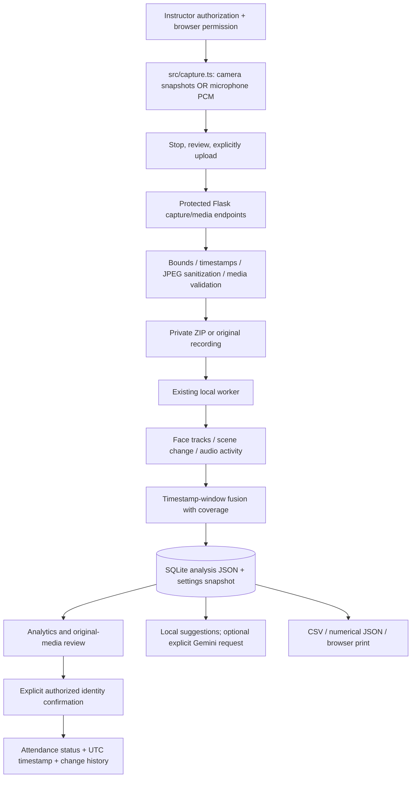
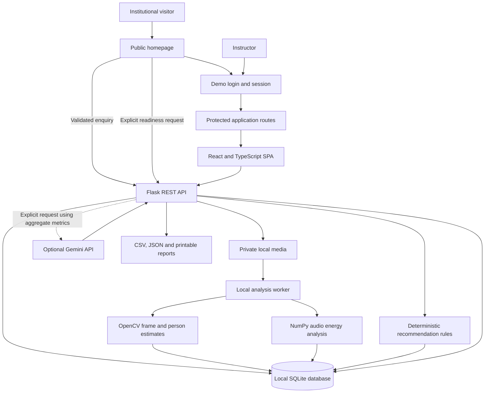

# Project Report — Classroom Insight

## October 30 submission addendum — current implementation and evidence

**Template status:** the official SkillWallet mandatory report template and original Instructions screenshot were not available in the repository. This Markdown document is a technical project report, **not a claim of template compliance**. The latest user-supplied 15-requirement checklist is mapped in [REQUIREMENTS_AUDIT.md](REQUIREMENTS_AUDIT.md#capstone-compliance-matrix--30-october-2026). Earlier sections below describe the original product and must be read with this addendum.

### Objectives and delivered extension

The project supports instructor-controlled attendance and cautious review of observable classroom activity. The final extension adds opt-in camera snapshot and microphone input to the existing recorded-media workflow, configurable sustained-presence thresholds, explicit unsupported-pose reporting, speech-like heuristic intervals and stronger privacy/resource tests. It does not recognize people or score individual attention, emotion, understanding or learning success.

Camera input is 2-second JPEG sampling, capped at 60 frames/120 seconds. Browser monotonic elapsed timestamps are retained; they are not independently verified wall-clock time. Microphone input is a maximum 120 seconds of mono PCM encoded into WAV, without audible monitoring. The browser holds capture in memory until Stop/Review/Upload; there is no automatic upload or cloud request. Capture is stopped and hardware released on close, cancellation, tab hiding, error or limit. Analysis remains asynchronous local batch processing after upload. There is no simultaneous camera/audio recording or continuous online inference in this implementation.

### Implemented workflow and modules

New modules are `src/capture.ts`, `src/LiveCapture.tsx` and `backend/capture.py`. Existing `FaceObserver`, `PresenceTracker`, `fuse_signals`, `record_attendance`, worker orchestration, API access guards and dashboard components were extended. New settings use the existing key/value table; no migration was added in this phase. The earlier attendance migration is additive and backs up SQLite before adding timestamp/source columns. Verification additionally initializes a disposable copy of the existing database and compares all copied rows; the actual database is never reset for testing.

### Observation methodology and limitations

Frontal Haar detections are linked with conservative one-to-one IoU matching. Qualification requires the saved duration/sample thresholds, default 20 seconds/three samples, never below those floors, and recording sampling no slower than 10 seconds. Ambiguity/misses/gaps break continuity. Qualification is not identity. Explicit instructor attestation and same-session roster membership are enforced before attendance is written; duplicate/cross-session and insufficient-evidence confirmations are rejected. Attendance timestamps record human confirmation time, not a guessed arrival time.

Movement is face-box displacement in face-widths/second; stillness uses a configurable default 0.02 threshold. **Head pose is unsupported.** Conditional eye-line roll is only 2D image geometry, not yaw/pitch/gaze or a calibrated pose estimate. No reliable model was available/evaluated to justify a stronger claim. Optional face crops are off by default for new analyses. Camera originals are protected JPEGs in a private ZIP; re-encoding removes metadata/trailing payloads.

Audio uses RMS energy and bounded speech-like intervals from energy, zero crossing and spectral-band heuristics. The first 360 heuristic intervals are returned with an explicit truncation flag; the fraction is calculated from all processed samples. These metrics can respond to music, tones or noise. No automatic speech recognition, verified speech VAD, speaker identification or conversation-turn understanding is implemented.

The experimental activity score is the equal mean of available normalized visual change (`min(change / 10%, 1)`) and sound-active duration fraction within aligned windows, scaled to 0–100, followed by duration-weighted averaging. Actual timestamps, missing-signal values and coverage are shown. Separate recordings require instructor-supplied alignment. The formula and 10% scale are uncalibrated heuristics; scores are not validated engagement measurements. They never justify claims about an individual learner's attention or success.

### Actual verification results

- **79 backend tests passed in 10.98s:** original API/auth/enquiry/provider regressions, real HTTP worker integration on synthetic AVI/WAV, camera multipart-to-analysis/frame/delete integration, validation, configured presence guards, timestamp/history/CSV, fusion, fallback, privacy and disposable-copy preservation.
- **43 frontend tests passed in 17.60s:** five files, including ten mocked-device capture tests, reviewed-upload contract, cancellation/late-permission cleanup, routes, forms, reports and public flows. The old eight-route timeout was corrected by making route cases independent, without dropping checks or raising the timeout.
- **TypeScript and production build passed:** 2,634 transformed modules; Vite reported 3.10s.
- **Bounded performance observation:** 60 synthetic blank 640×480 JPEG frames (331,253-byte ZIP) processed in 0.898s; the dedicated test passed in 1.48s. This is not representative classroom performance, concurrency testing or an accuracy result.
- **Real browser verification:** on a disposable local database, homepage/login, fictional session creation, capture controls at 1440×1000 and 390×844, setting persistence after refresh, all eight routes, sign-out and protected-route behavior succeeded. Devices were not accessed. No real recording, positive-face/browser identity review, native print/download or screen-reader validation was performed.
- **Optional Gemini:** existing integration is retained and provider error/schema paths are tested with mocks; no fresh live generation in this phase. Local advice was exercised without a key over actual HTTP. Do not equate a supplied key or model availability with a successful generation.

Synthetic fixtures and mocked positive faces/eyes are clearly separate from real classroom validation. There is no labelled evaluation dataset or defensible real-world accuracy/fairness metric. Missing hardware/provider checks are not marked passed. Exact commands and test names are in the linked audit and [SUBMISSION_STATUS.md](SUBMISSION_STATUS.md).

### Submission evidence and references

The existing [screenshot guide](SCREENSHOTS.md) describes historical real-browser gallery assets. New capture views were inspected in the browser, but writing fresh screenshot files through that tool was denied; no placeholder files or fabricated screenshots were added. Capture current screenshots manually if required by the official template.

Primary implementation references: [capture backend](../backend/capture.py), [browser capture lifecycle](../src/capture.ts), [observation algorithms](../backend/observations.py), [audio/video processing](../backend/analysis.py), [capture API tests](../tests/test_capture.py), [device-mock tests](../src/capture.test.tsx), [API contracts](API.md), [architecture/schema](ARCHITECTURE.md). Existing external framework references below provide technology context, not evidence of this project's accuracy or compliance.

### Remaining work before broader deployment

Obtain and match the official report template; perform consented real camera/microphone and positive-face tests; evaluate occlusion, crossings, noisy rooms, codecs and real resource usage; verify native exports/accessibility; replace shared demo authentication before institutional deployment. Genuine pose, ASR or individual engagement require suitable models, defensible definitions and validation rather than renamed heuristics. Local storage is not automatically encrypted/compliant; optional cloud AI requires a network and sends only disclosed aggregates/descriptions.

---

## Original product report (read with the current addendum above)

**Multimodal Attendance & Engagement Agent**

## 1. Abstract

Classroom Insight is a local-first instructor workspace designed to manage attendance, analyze observable classroom media signals, visualize session-level trends, and provide evidence-linked teaching suggestions.

The application combines a React and TypeScript frontend with a Flask backend and SQLite database. It supports roster-based attendance, student and session management, local video and audio analysis, reporting, and optional Gemini-powered recommendations.

The system distinguishes confirmed attendance records, anonymous media-derived estimates, and explicitly labelled synthetic demonstration data. Its recommendations are intended to support instructor reflection rather than evaluate students or make automated educational decisions.

Classroom Insight is a single-instructor local demonstration. It is not a production-ready institutional platform.

## 2. Objectives

The primary objectives are to:

- Maintain explicit, persistent attendance records.
- Provide an organized workspace for students, sessions, and classroom reports.
- Extract limited, explainable observations from supported video and audio recordings.
- Present classroom signals through visualizations and session-level summaries.
- Generate rule-based suggestions and optionally request AI-assisted guidance.
- Keep media files, database records, and provider credentials under backend control.
- Separate demonstration data and heuristic observations from verified facts.
- Document limitations, privacy considerations, and future deployment requirements.

## 3. System Architecture

The frontend handles navigation, forms, filtering, and visualization. The Flask backend validates requests, enforces application access rules, coordinates database operations, processes media, and serves API responses.

During development, Vite serves the frontend and proxies API requests to Flask. In the local built configuration, Flask can serve the frontend and API from the same origin.

The diagram represents the major application flows. Actual request handling, worker lifecycle, and persistence behavior are defined by the implementation.

### 3.1 Technology stack

| Layer | Technologies |
|---|---|
| Frontend | React, TypeScript, Vite |
| UI and visualization | Tailwind CSS v4, Lucide React, Recharts, React Router |
| Backend | Python, Flask |
| Database | SQLite |
| Video analysis | OpenCV |
| Audio analysis | NumPy |
| Optional audio decoding and extraction | FFmpeg |
| AI integration | Official `google-genai` Python SDK |
| Validation | Pydantic and application-level validation |
| Testing | pytest and Vitest |

## 4. Main Modules

| Module | Responsibility |
|---|---|
| `backend/app.py` | Application factory, API routes, request restrictions, upload orchestration, and built-SPA serving |
| `backend/db.py` | SQLite schema, database connections, preferences, and event records |
| `backend/analysis.py` | Video sampling, optional HOG person estimates, audio energy analysis, and optional FFmpeg extraction |
| `backend/recommendations.py` | Deterministic recommendations, aggregate prompt construction, provider checks, and fallback behavior |
| `backend/portal.py` | Public enquiries, input validation, idempotency, and hashed demo sessions |
| `backend/readiness.py` | Schema-validated readiness generation |
| `backend/capabilities.json` | Server-maintained catalogue of supported capabilities and limitations |
| `src/App.tsx` | Public and operational routing, session checks, redirects, and sign-out |
| `src/Dashboard.tsx` | Dashboard navigation, API state, notifications, and shared dialogs |
| `src/pages.tsx` | Eight operational dashboard sections |
| `src/public/` | Homepage, login and consultation dialogs, product preview, and readiness workflow |
| `src/forms.tsx`, `src/ui.tsx` | Shared forms and UI controls |
| `src/charts.tsx`, `src/ChartView.tsx` | Chart presentation and visualization helpers |
| `shared/institution-options.json` | Institution-related options shared between Python and TypeScript |
| `src/styles.css`, `src/public/public.css` | Design tokens, layout, responsive styles, and public-page presentation |

## 5. Functional Scope

### 5.1 Public website and portal

The public homepage introduces the product and explains its workflow. It includes interactive illustrative examples, an Employee Login dialog, a consultation request form, and an optional Institution Readiness Brief.

The operational application provides eight sections:

1. Overview
2. Attendance
3. Sessions
4. Engagement Analytics
5. Recommendations
6. Students
7. Reports
8. Settings

The login uses deliberately public demo credentials and a server-managed session. The dashboard identifies the environment as Demo Mode. This supports a predictable evaluation workflow but does not constitute real employee identity management or institutional authorization.

### 5.2 Attendance management

The application maintains attendance entries associated with students and sessions. Attendance states distinguish present, absent, and unconfirmed records.

Attendance rates are calculated as confirmed-present entries divided by all roster entries, including unconfirmed entries. Aggregate rates use student-session entries rather than unique students.

Historical session rosters are snapshots. Anonymous person detection does not automatically mark a student present.

### 5.3 Student and session management

The workspace supports student records, session creation, attendance workflows, and historical session information. Sample students, sessions, and analyses have explicit demonstration markers.

Loading sample data is a separate action from creating real records. Sample students do not automatically enter real session rosters, and uploaded media cannot be attached to sample sessions.

### 5.4 Analytics and reporting

The application visualizes available attendance and media-derived observations. It also supports recommendations, student histories, and available report exports.

Charts and summary metrics describe the available records and computed signals. They do not independently establish learning outcomes or student attention.

### 5.5 Institutional enquiries

The consultation form collects institution and contact information through a multi-stage workflow. Browser and backend validation are applied, and idempotency helps prevent duplicate records when a request is retried.

Enquiries persist in SQLite with a generated reference, submission details, consent information, status, and idempotency-related metadata.

**The current workflow does not send email notifications.** Enquiry retention and access remain local operational responsibilities.

### 5.6 Institution Readiness Brief

The readiness workflow accepts institution type, non-identifying workflow information, goals, requirements, and deployment preferences.

Generation occurs only after an explicit request. The backend uses `backend/capabilities.json` as its maintained capability catalogue. Model-selected capability IDs are mapped to server-controlled descriptions and limitations.

Pydantic validation constrains the structure of generated output. It does not guarantee that every generated statement is factually correct. Results are labelled as advisory, and failures should be reported explicitly rather than presented as successful generation.

## 6. Data Model and Persistence

SQLite stores classroom records, analysis results, recommendations, settings, and event history. The final portal phase adds institutional enquiry records, hashed demo-session tokens, and local rate-limit counters without intentionally replacing existing classroom data.

The primary entities include:

- **Students:** institutional identifier and optional cohort.
- **Sessions:** title, date, instructor, and session metadata.
- **Attendance:** student-session relationship and attendance state.
- **Analyses:** processing metadata and structured JSON results.
- **Recommendations:** source, evidence, timestamp, and session association.
- **Settings and events:** local preferences and event history.
- **Institutional enquiries:** reference, contact details, submission details, consent, status, and idempotency metadata.
- **Demo sessions:** hashed session tokens and expiration information.
- **Rate-limit records:** local request-control counters.

Database relationships, column definitions, and additional implementation details are documented in [ARCHITECTURE.md](ARCHITECTURE.md).

Media paths are managed by the backend and are not exposed as public static files. The local database is not encrypted by the application.

## 7. Design and User Experience

The interface uses a warm editorial visual language built around ivory, forest green, muted sage, and restrained amber.

- **DM Serif Display** is used for selected editorial headings.
- **Manrope** provides interface typography.
- Fonts are bundled locally with system fallbacks.
- The public homepage uses an asymmetric hero, product preview, numbered sections, and illustrative timelines.
- The desktop dashboard uses a persistent sidebar, while narrower layouts use a navigation drawer.
- Charts use consistent visual conventions and supporting summaries.
- Tables scroll within their own containers on smaller screens.
- Forms use labels and validation; dialogs use native modal semantics where implemented.
- Reduced-motion styling and a print stylesheet are included in the frontend.

Responsive styling and component tests do not replace a complete real-browser accessibility and visual review. See [VERIFICATION.md](VERIFICATION.md) for the recorded verification boundary.

## 8. Algorithms and Analytical Limitations

### 8.1 Person estimates

The bundled OpenCV HOG/SVM pedestrian detector estimates visible pedestrian-like objects without a separate model download.

It does not identify individuals. Its recall is poor for seated or occluded classroom participants, so it must not be treated as a reliable classroom headcount.

### 8.2 Scene-change analysis

Scene change is estimated from the mean absolute difference between sampled grayscale frames, expressed as a percentage of the intensity range.

The first sample has no preceding frame and therefore has a null difference. Results depend on sampling intervals, camera stability, and lighting.

### 8.3 Audio energy analysis

Audio processing calculates one-second RMS energy windows and applies an adaptive activity threshold:

`max(0.015, 2 × 20th-percentile RMS)`

The output includes sound-active intervals and a duration fraction. This is an energy-based signal, not speech recognition, transcription, or speaker attribution.

### 8.4 Rule-based recommendations

The documented recommendation rules include heuristic triggers for:

- Outstanding attendance.
- Low sampled scene change below 3% for at least 120 seconds.
- Scene-change range above 15 percentage points.
- Sound-active fraction below 20%.

These thresholds are prompts for instructor review, not validated educational diagnoses. Camera movement, recording conditions, and environmental noise can affect the underlying signals.

### 8.5 Multimodal interpretation

The system presents available observations from video and audio processing, but those observations should not be interpreted as definitive evidence of student engagement, emotion, understanding, or learning.

The system does not implement facial identification, emotion detection, covert recording, or individual attention scoring.

## 9. Privacy and Security

Classroom Insight is designed for a trusted, single-user local computer.

- The database and media remain in local application storage.
- Operational routes require demo access.
- The frontend does not contain database credentials or provider API keys.
- Gemini dashboard requests are explicitly triggered and use aggregate metrics rather than student names, identifiers, or media.
- Readiness generation sends user-entered workflow information to Gemini only after an explicit request.
- Public enquiry records are not exposed through a public listing endpoint.
- Exported files may contain student information and must be handled carefully.
- Retention is manual rather than automatic.

The local demo session mechanism is not a substitute for real authentication. Local rate limits are not distributed abuse protection, and application-level checks do not eliminate risks from untrusted media decoders.

## 10. Verification Summary

The verification record dated 29 October 2026 reported:

- 45 backend pytest tests passed.
- 19 frontend Vitest tests passed across three files.
- TypeScript and Vite production build passed.
- `pip check` passed.
- Live Flask/Vite integration and portal persistence checks passed.
- Synthetic WAV and AVI analysis workflows passed for the tested paths.
- A real Gemini readiness request returned HTTP 200 and passed schema validation.
- A recorded source and production-bundle secret-pattern scan found no matching configured credentials.

These are recorded results from the verification report, not a claim that every test was rerun for this document revision.

Eleven screenshot PNG files were included in the initial Git commit. The readiness-brief and mobile-homepage screenshots remain pending. The final public homepage's complete browser visual review and native modal keyboard behavior were not verified because local browser automation was unavailable during the final phase.

Synthetic tests demonstrate execution and expected behavior for tested inputs. They do not establish real-world attendance accuracy, engagement validity, or production reliability.

See [VERIFICATION.md](VERIFICATION.md) for detailed evidence, historical test results, and remaining limitations.

## 11. Scope and Future Work

Before institutional deployment, the project would require:

- Real authentication and role-based institutional authorization.
- Tenant isolation and secure account management.
- HTTPS and production cookie configuration.
- Managed backups and enforceable retention policies.
- Explicit consent and governance procedures for classroom recordings.
- Configured enquiry notifications.
- Isolated media-processing workers, resource quotas, and robust job management.
- Independent privacy and security review.
- Real-browser accessibility and responsive testing.
- Evaluation using consented classroom recordings and documented accuracy metrics.

Future detection models should report validation data and uncertainty and must not replace instructor confirmation.

Cloud and integration preferences in consultation forms are discovery inputs, not proof that those integrations are implemented.

## 12. Conclusion

Classroom Insight provides a local instructor workspace combining attendance management, session analytics, media-derived observations, reporting, and optional AI-assisted guidance.

Its principal design goal is to keep recorded facts, heuristic signals, synthetic demonstration data, and generated suggestions distinguishable. The system is suitable for local demonstration and evaluation within its documented limitations.

It should not be treated as a validated classroom surveillance, student-attention measurement, or automated educational decision-making system.

**Related documentation**

- [README](../README.md)
- [Implementation architecture](ARCHITECTURE.md)
- [REST API reference](API.md)
- [Screenshot guide](SCREENSHOTS.md)
- [Screenshot index](screenshots/README.md)
- [Verification record](VERIFICATION.md)
