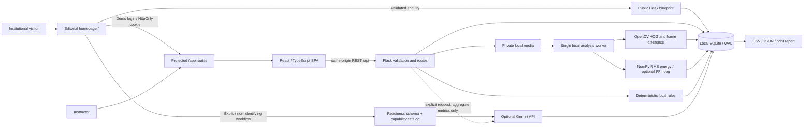

# Project report — Classroom Insight

## Purpose

Provide an instructor with accurate attendance records and limited, explainable observations from classroom media. Keep measured signals, anonymous estimates and simulated demonstration data distinct. Suggestions assist reflection; they do not evaluate students.

## Architecture

The frontend owns navigation, forms, filters and visualization. It has no SQLite or provider credentials. Flask validates inputs, parameterizes SQL, initializes the schema, processes media and exports records. Browser requests use a Vite proxy in development and same-origin Flask in a built local installation.

## Modules

- `backend/app.py`: application factory, REST routes, local request restrictions, upload orchestration and SPA serving.
- `backend/db.py`: schema, connections, preferences and audit events.
- `backend/analysis.py`: bounded OpenCV sampling, optional HOG estimates, streamed PCM audio indicators, optional FFmpeg extraction.
- `backend/recommendations.py`: transparent rules, aggregate prompt construction, model verification, provider fallback.
- `src/App.tsx`: public/application routing, session check, legacy redirects and sign-out.
- `src/Dashboard.tsx`: preserved operational navigation, API state, notifications and global dialogs.
- `src/public/`: editorial homepage, locally rendered product visuals, consultation and login dialogs, readiness form/result.
- `src/Brand.tsx`: shared custom SVG brand mark and wordmark.
- `backend/portal.py`: bounded public endpoints, enquiry validation/idempotency and hashed demo sessions.
- `backend/readiness.py`, `backend/capabilities.json`: schema-validated Gemini generation grounded in maintained capabilities.
- `shared/institution-options.json`: option values shared between Python and TypeScript.
- `src/pages.tsx`: eight operational screens.
- `src/ui.tsx`, `src/forms.tsx`, `src/charts.tsx`: shared accessible controls, forms and chart language.
- `src/styles.css`: Tailwind v4 design tokens and reusable component styles.

## Data model

Students have a unique case-insensitive institutional identifier and optional cohort. Sessions store a title, date and instructor. Attendance is a student-session relationship with present/absent/unconfirmed state and cascades on deletion. Analyses store processing metadata and JSON results; media paths never leave the backend. Recommendations record their source, evidence, timestamp and session. Sample students/sessions/analyses have explicit demo markers. Preferences and event history persist in SQLite. The final phase adds three tables without replacing prior data: institutional enquiries (reference, contact, complete JSON details, consent, status, idempotency/payload hashes), expiring hashed demo sessions and local public rate-limit counters. Public users cannot list enquiry records.

## Design decisions

The product uses warm paper, forest green, sage and sparse amber. Locally bundled DM Serif Display provides selective editorial headings; Manrope provides interface text, with system fallbacks. The public website uses an asymmetric hero, a fine-line product notebook, numbered section rules, a process sequence and two interactive illustrative timelines. Font files are served locally and primary Latin faces are preloaded. Tables and section separators carry structure instead of excessive cards. Charts share neutral axes and clear units. No attention score, fabricated confidence percentage or inferred emotional state appears.

Desktop has a persistent sidebar; narrower screens use a navigation drawer. Forms use native labels and validation, dialogs use the native modal focus trap, status updates are announced, and data tables scroll within their own container on mobile. Charts have text captions and surrounding measurement summaries. Reports have a print stylesheet.

## Algorithms and limitations

HOG detects pedestrian-shaped features. It cannot establish identity and its recall for seated classroom participants is poor. Frame difference measures changes in image intensity; its value depends on sampling interval, camera stability and illumination. RMS measures energy and threshold crossings, not verified speech or participation. Neither measures learning or mental attention.

Local recommendations use explicit triggers: outstanding attendance, low sampled scene change below 3% for at least 120 seconds, scene-change range above 15 percentage points, and sound-active fraction below 20%. These are heuristic prompts for instructor review, not validated educational diagnoses. Gemini is optional and receives only aggregate metrics; access checks do not guarantee future model availability or quota. Its text must be reviewed.

## Scope and future institutional work

The working submission is a local, single-user application with explicitly public demo credentials. HttpOnly server sessions support a predictable evaluator flow, not real institutional security. Before campus-wide deployment: replace demo access with real authentication and role/tenant authorization, add encrypted backups, retention enforcement, consent records, configured enquiry notifications, independent security review, distributed abuse controls, robust isolated job processing and evaluation against consented classroom recordings. A future classroom detector should report validation data and confidence limits, not replace instructor confirmation. Cloud and integration preferences in enquiry forms are discovery inputs, not implemented capabilities.

The readiness brief uses real Gemini generation only on explicit request and sends no stored records. Capability descriptions and fixed limitations are server-controlled. Generated prose remains advisory: schema validation constrains shape, not factual certainty. An actual generation using fictional workflow details passed schema validation on 2026-10-29. Browser automation for this final phase was disabled in Work settings; DOM interaction tests do not establish visual layout or native focus-trap correctness.

See VERIFICATION.md for executed tests and remaining verification boundaries.
