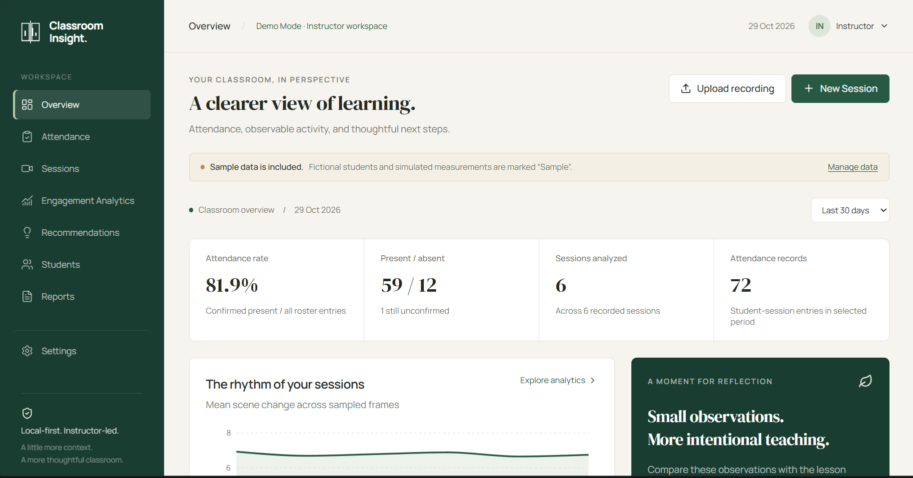

# Classroom Insight — Screenshot Guide

This document tracks the screenshots available for the Classroom Insight project, provides instructions for capturing the remaining screens, and defines the visual and privacy checks required before submission.

All screenshots must come from the actual running application. Do not create placeholder images, reconstruct the interface, or present illustrative data as real classroom measurements.

## 1. Screenshot Status

Screenshots are stored in `docs/screenshots/`.

### Captured files

The following 11 screenshot files were added to the initial Git commit:

| Screen | Filename | Status |
|---|---|---|
| Public Homepage | `public-homepage.png` | Captured |
| Employee Login | `employee-login.png` | Captured |
| Consultation Form | `consultation-form.png` | Captured |
| Dashboard Overview | `dashboard.png` | Captured |
| Attendance | `attendance.png` | Captured |
| Sessions | `sessions.png` | Captured |
| Engagement Analytics | `engagement-analytics.png` | Captured |
| Recommendations | `recommendations.png` | Captured |
| Students | `students.png` | Captured |
| Reports | `reports.png` | Captured |
| Settings | `settings.png` | Captured |

The filenames are recorded in Git. Their presence alone does not certify image quality, correct page state, or absence of sensitive information. Review each image before sharing the repository publicly.

### Pending screenshots

| Screen | Filename | Capture instructions |
|---|---|---|
| Institution Readiness Brief | `readiness-brief.png` | Capture an actual generated Gemini brief with its advisory label visible. |
| Mobile Homepage | `mobile-homepage.png` | Capture the real homepage at a mobile viewport. |

Do not mark either screenshot complete until the corresponding PNG exists and has been reviewed.

## 2. Run the application

From the project root, start the backend in the first PowerShell terminal:

```powershell
cd D:\Coding\classroom-insight
.\.venv\Scripts\python.exe -m backend.app
```

Start the frontend in a second terminal:

```powershell
cd D:\Coding\classroom-insight
npm run dev
```

Open the development website:

`http://127.0.0.1:5173/`

Keep both terminals running while capturing screenshots.

For setup requirements and optional Gemini configuration, see the root [README](../README.md).

## 3. Capture the remaining screenshots

### Institution Readiness Brief

1. Open the public homepage.
2. Navigate to the Institution Readiness Brief section.
3. Select **Use sample information** if available.
4. Choose **Generate Brief** to request a real Gemini-generated result.
5. Wait for the result to finish rendering.
6. Capture the actual brief with the **Generated by Gemini · advisory** label visible.
7. Save it as `docs/screenshots/readiness-brief.png`.

If Gemini is unavailable or generation fails, do not substitute a static example or fabricate a successful result. Leave the screenshot pending or document the actual error state separately.

### Mobile Homepage

1. Open Chrome and navigate to the public homepage.
2. Open Developer Tools with `F12`.
3. Toggle the device toolbar with `Ctrl + Shift + M`.
4. Select a mobile device or configure a viewport of approximately **390 × 844 CSS pixels**.
5. Reload the page and wait for fonts and layout to settle.
6. Check that the hero, navigation and primary actions fit without unintended horizontal overflow.
7. Capture the actual rendered page and save it as `docs/screenshots/mobile-homepage.png`.

The capture must show the real responsive website, not a resized desktop screenshot.

## 4. Screenshot quality and privacy

Before adding or sharing a screenshot, verify that:

- The image opens successfully and shows the intended screen.
- Text, charts, navigation and important controls are legible.
- No loading spinner, unexpected error or blank state obscures the intended content.
- No API keys, private credentials, personal contact information or sensitive student information are visible.
- The login image does not expose a typed password.
- Sample classroom records are identified as fictional wherever applicable.
- Generated AI content is clearly labelled as advisory.
- The image was captured from the real running application.

Use fictional enquiry details and non-sensitive sample data. Never upload private classroom recordings or personal student information merely to produce a portfolio screenshot.

## 5. Recommended visual checks

For a more complete evaluation, manually inspect the application at these viewport sizes:

| Viewport | Purpose |
|---|---|
| 1440 × 1000 | Desktop layout, dashboard metrics and charts |
| 768 × 1024 | Tablet layout, tables and forms |
| 390 × 844 | Mobile navigation, content flow and responsive layout |

Check the following where applicable:

- Login and consultation modal layout.
- Keyboard navigation using Tab and Shift+Tab.
- Escape, backdrop and close-button behavior.
- Focus restoration after closing a modal.
- Background scroll locking and modal-body scrolling.
- Reduced-motion behavior.
- Local font loading.
- Table and chart overflow.
- Sign-out and protected-route behavior.

These checks must be performed in the actual browser. Passing component tests alone does not establish correct native-browser behavior.

## 6. Embedding screenshots in Markdown

Use relative paths from the repository root in `README.md`, or paths relative to the relevant Markdown file.

For example, in the root README:

```markdown

```

Inside this file, the equivalent path is:

```markdown

```

Only embed images that exist and have been reviewed. Do not leave broken image links for pending captures.

## 7. Final verification checklist

Before submission:

- [ ] All 11 existing PNG files open correctly.
- [ ] Existing images have been checked for sensitive information.
- [ ] `readiness-brief.png` has been captured and reviewed, or is explicitly marked pending.
- [ ] `mobile-homepage.png` has been captured and reviewed, or is explicitly marked pending.
- [ ] README image paths resolve correctly.
- [ ] Desktop, tablet and mobile layouts have been manually inspected where possible.
- [ ] Remaining visual or browser limitations are documented honestly.

See [screenshots/README.md](screenshots/README.md) for the screenshot index and capture notes, and [VERIFICATION.md](VERIFICATION.md) for the project's verification evidence and known limitations.